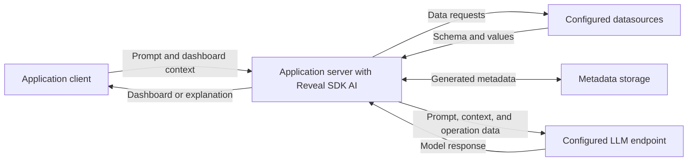

# Data Handling

Reveal SDK AI processes user prompts, dashboard information, and datasource metadata to generate dashboards and answer questions. **Metadata can include actual values from your data.** Insights and chat analysis also use visualization data and calculation results.

The server SDK runs in your application's server environment. It reads data through the Reveal data engine, prepares the information needed for an AI operation, and sends requests through the configured language model provider. Your application controls the available datasources, provider connections, and user access.

## Data flow



For built-in provider integrations, the AI request goes from your server to the provider endpoint selected by your configuration. A custom provider, gateway, or self-hosted model can change that route. See [AI Providers and Profiles](/ai/providers-overview/) and [Custom Endpoints](/ai/providers-custom-endpoints/).

## What is sent to the model

The payload depends on the operation and may span several model calls. A single chat request can involve intent classification, dashboard generation, filtering, or analysis.

| Operation | Information that can be included |
|---|---|
| Create or edit a dashboard | The user's message, relevant conversation history, application-supplied context, datasource identifiers, table and field definitions, descriptions, aliases, and the dashboard specification needed for the request. Generated datasource descriptions can include sampled field values. |
| Create or adjust filters | Dashboard and filter definitions, existing selections, and available field values from generated metadata. These values help the model map a request such as “show the West region” to values the datasource accepts. |
| Generate Insights or analyze data in chat | Data extracted for the selected visualization or dashboard, formatted values, the question or insight instruction, and calculation results. Chat analysis can also include conversation history and application-supplied context. |
| Enrich metadata with AI, when enabled | Schema information, existing descriptions, field statistics, and sample field values used to generate descriptions and aliases. |

### Dashboard generation and filtering

The [metadata catalog](/ai/metadata-catalog/) identifies the datasources available to AI. Generated metadata adds information from those sources, including field types, distinct-value counts, numeric ranges, and cached filter values. Descriptions and aliases supplied by your application may also contain business information or example values.

Filter values are collected for individual fields. The SDK can include those values, or samples of them, in model prompts. The sample size and selection vary by operation and generation path; they are not a limit on all data sent during a request. Treat both generated metadata and authored catalog content as data that may be shared with the selected model provider.

### Insights and chat analysis

[Insights](/ai/sdk-insights/) reads visualization results through the Reveal data engine and sends formatted data to the model for summary, analysis, or forecasting. Chat can invoke the same analysis workflow when a question requires it.

The data reflects the visualization's fields, filters, and aggregations. A visualization that exposes detail records can therefore supply detailed values rather than only totals. Analysis can perform calculations against the fetched data and send their results in later model calls. Formatting and sampling limits on an initial prompt do not bound all subsequent calculation output.

Your application decides when to request Insights and which AI operations users can access. If your deployment must restrict analysis data, apply that restriction to chat analysis as well as to the Insights interface.

### Optional metadata enrichment

AI-based semantic enrichment is disabled by default in the built-in metadata manager. Enabling `MetadataManagerOptions.EnableSemanticEnrichment` allows metadata generation to call the model to improve descriptions and aliases. Those calls can include actual sample field values.

Disabling semantic enrichment does not stop ordinary metadata generation from reading and caching field values, or stop dashboard and filter prompts from using metadata.

## Storage and conversation history

### Generated metadata

The default metadata storage provider writes JSON files in the server environment. Those files can contain schema details, descriptions, statistics, and cached values. Configure the output location through `MetadataManagerOptions.OutputPath`, or use a [Metadata Storage Provider](/ai/metadata-storage-provider/) to control persistence and visibility.

Protect metadata storage and its backups as you would the underlying data. Apply appropriate filesystem or storage permissions, encryption at rest, and a deletion policy. Metadata regeneration and freshness settings do not establish a retention or deletion policy.

### Chat state

The built-in chat state manager keeps conversation state in server-process memory across requests. This can include questions, answers, dashboard versions, and analysis results. The built-in manager does not apply a time-based expiration policy; state is removed when its session is cleared, replaced when the session changes datasource or database, or lost when the process ends.

`ChatManagerOptions.MaxHistoryTurns` defaults to 20 and controls the recent conversation history selected for prompts. The latest dashboard-bearing turn can also be retained outside that window. This setting does not delete older turns from the in-memory session. Some generation paths also use earlier dashboard versions as context.

Use the [chat API](/ai/sdk-chat/) to clear the current conversation:

```typescript
await client.ai.chat.resetContext();
```

Clearing SDK chat state does not delete metadata files, saved dashboards, application logs, or copies held by an external provider. Apply the corresponding deletion controls separately.

### Provider caching and logs

Provider-side caching is separate from SDK metadata storage and chat state. The OpenAI and Anthropic adapters enable their `PromptCaching` option by default. The effect depends on the model and API, and cached content can include schema, context, or conversation content. Review caching settings and the provider's terms for your deployment; disabling an SDK caching option is not a general no-retention guarantee.

The SDK produces operational logs and usage records, such as request outcomes, identifiers, model usage, and token counts. Error details and application-defined diagnostics can contain additional information. Review log destinations, access, redaction, and retention, including any HTTP tracing, custom provider, or usage sink configured by your application.

## Application and provider responsibilities

Configure the complete data path for your deployment:

- **Authenticate and authorize requests.** Protect AI endpoints and enforce access to dashboards, datasources, metadata, and profiles. On ASP.NET Core, `RevealAI.AuthorizationPolicy` applies an application-defined authorization policy to the AI endpoints.
- **Supply trusted user and tenant context.** Use server-validated identity and enforce tenant boundaries in datasource access and metadata storage. The default JSON metadata store is shared within its configured location; it does not filter metadata by user or tenant. Use tenant-aware storage and identifiers where needed.
- **Limit sensitive content before model calls.** Review source permissions, catalog descriptions, cached values, user prompts, and custom context. The built-in provider request path does not automatically redact sensitive content. Use approved views, filtering, or redaction before exposing that information to AI.
- **Control connections and credentials.** Keep provider credentials on the server and make only approved profiles and endpoints available. Intent routing can select different profiles for different steps, so review every provider used by a workflow.
- **Set lifecycle controls.** Define retention and deletion for metadata, chat state, saved dashboards, logs, backups, and any application-managed storage. Configure transport security and storage protection for each service in the path.

Model-provider retention, training use, data location, and access policies depend on the service, account, endpoint, and agreement you use. Verify those policies with your provider and include any gateway or hosting service in that review. SDK configuration alone does not establish those guarantees for your deployment.
