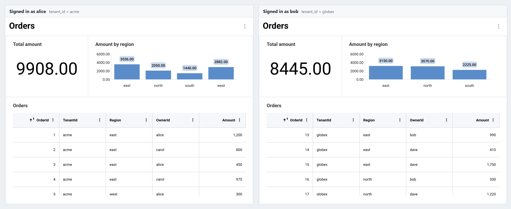
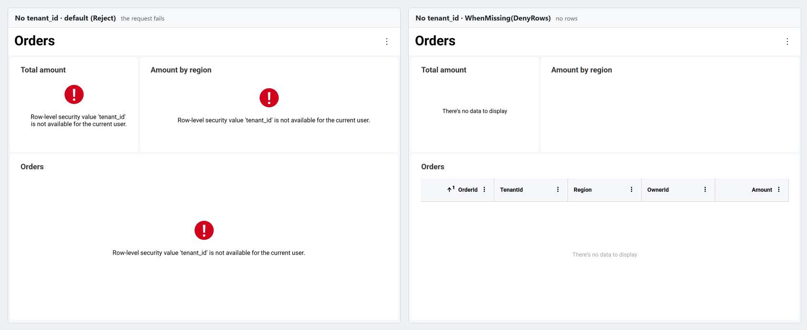

import Tabs from '@theme/Tabs';
import TabItem from '@theme/TabItem';

# Row-Level Security

Row-level security (RLS) controls which rows of a data source each user can read. You define a **row filter** on the server for a data source item, such as "the row's `TenantId` must equal the user's tenant", and Reveal applies it to every query that reads that item: visualizations, totals, dashboard filter values, blended data and exports. Every user opens the same dashboard and sees only their own rows.



## How It Works

You set a row filter in your [data source provider](replacing-datasources.md), the server-side callback that Reveal calls for every data source item a request reads. The filter is built from the [user context](user-context.md) of the current request: the user id, roles and any other values (claims) your server knows about the signed-in user.

- **The filter stays on the server.** It's never sent to the client, and nothing a client sends can remove or replace it.
- **The filter runs before any aggregation.** For a database, it's part of the query's `WHERE` clause. Totals, pivot grand totals, filter value lists and blended data are computed only from the rows the user can see.
- **Values are sent as query parameters.** User context values are never concatenated into the query text, so a value can't change the query.
- **Caching respects the filter.** Results are cached per filter value, so results computed for one user are never served to a user whose filter values differ.
- **It fails closed.** When a filter can't be applied, for example because a value it needs is missing, the request fails instead of returning unfiltered rows.

:::info
Row-level security is configured entirely on the server. The JavaScript client has no row-level security API, and your client code doesn't change.
:::

### Requirements

- **Engine2.** Row filters are applied by Engine2, Reveal's data-processing engine, which is enabled by default (`Engine2Enabled` in ASP.NET, `setEngine2Enabled` in Java, the `engine2Enabled` option in Node.js). If Engine2 is disabled, or a request can't run on it, any request that reads an item with a row filter fails with the error "Row-level security is only available on Engine2, and this request cannot run on it".
- **Tabular data source items.** A row filter is a property of tabular data source items: database items such as tables, views, custom queries and stored procedures, and CSV, Excel and JSON file items.

## Setting Up Row-Level Security

**Step 1** - Put the values your filters need into the user context.

Read them from the identity your authentication has already established, never from values the client sends. Every property of the user context is a value a filter can read by name. Roles are stored in the well-known `Roles` property.

<Tabs groupId="code" queryString>
  <TabItem value="aspnet" label="ASP.NET" default>

```cs
public class UserContextProvider : IRVUserContextProvider
{
    public IRVUserContext GetUserContext(HttpContext aspnetContext)
    {
        // The signed-in user, as your authentication middleware established it
        var user = aspnetContext.User;

        var properties = new Dictionary<string, object>
        {
            ["tenant_id"] = user.FindFirstValue("tenant_id"),
            ["regions"] = user.FindAll("region").Select(c => c.Value).ToArray(),
        };

        return new RVUserContext(user.FindFirstValue(ClaimTypes.NameIdentifier), properties)
        {
            Roles = user.FindAll(ClaimTypes.Role).Select(c => c.Value).ToArray()
        };
    }
}
```

  </TabItem>

  <TabItem value="java" label="Java">

```java
public class UserContextProvider extends RVContainerRequestAwareUserContextProvider {
    @Override
    protected IRVUserContext getUserContext(ContainerRequestContext requestContext) {
        // The signed-in user, as your authentication layer established it; AppUser is your own user model
        AppUser user = users.find(requestContext.getSecurityContext().getUserPrincipal().getName());

        RVUserContext userContext = new RVUserContext(user.getId());
        userContext.setClaim("tenant_id", user.getTenantId());
        userContext.setClaim("regions", user.getRegions()); // a List<String>
        userContext.setRoles(user.getRoles());              // a String[]
        return userContext;
    }
}
```

  </TabItem>

  <TabItem value="node" label="Node.js">

```js
const userContextProvider = (request) => {
  // The signed-in user, as your authentication middleware established it
  const user = request.user;

  const userContext = new reveal.RVUserContext(user.id, new Map());
  userContext.setClaim("tenant_id", user.tenantId);
  userContext.setClaim("regions", user.regions); // an array of strings
  userContext.roles = user.roles;
  return userContext;
};
```

  </TabItem>

  <TabItem value="node-ts" label="Node.js - TS">

```ts
const userContextProvider = (request: IncomingMessage) => {
  // The signed-in user, as your authentication middleware established it
  const user = (request as any).user;

  const userContext = new RVUserContext(user.id, new Map<string, Object>());
  userContext.setClaim("tenant_id", user.tenantId);
  userContext.setClaim("regions", user.regions); // an array of strings
  userContext.roles = user.roles;
  return userContext;
};
```

  </TabItem>
</Tabs>

A value can be a string, a number, a boolean or a date, or a collection of them for the multi-value filters described below. The name `UserId` is reserved: a filter that reads `UserId` always gets the user id of the user context.

:::danger
Never fill the user context from values the client sends for this purpose, such as headers set with `setAdditionalHeadersProvider`. Anyone can change those values in their browser and read another user's rows. Use the identity your server has verified: an authentication cookie, a validated token, or your own session store.
:::

**Step 2** - Set a row filter on the data source items in your data source provider.

The data source item your provider receives comes from the client. Before setting a filter, set everything that decides what the item reads, such as the table, schema, custom query or stored procedure of a database item, using values from your server. Throw an exception for items your application doesn't serve: returning `null` keeps the item as the client sent it.

<Tabs groupId="code" queryString>
  <TabItem value="aspnet" label="ASP.NET" default>

```cs
public class DataSourceProvider : IRVDataSourceProvider
{
    private static readonly string[] Tables = { "Orders", "Customers" };

    public async Task<RVDataSourceItem> ChangeDataSourceItemAsync(IRVUserContext userContext, string dashboardId, RVDataSourceItem dataSourceItem)
    {
        await ChangeDataSourceAsync(userContext, dataSourceItem.DataSource);

        if (dataSourceItem is RVSqlServerDataSourceItem sqlItem)
        {
            // Decide on the server what the item reads
            var table = Tables.FirstOrDefault(t => string.Equals(t, sqlItem.Table, StringComparison.OrdinalIgnoreCase))
                ?? throw new InvalidOperationException($"Table '{sqlItem.Table}' is not available.");
            sqlItem.Schema = "dbo";
            sqlItem.Table = table;
            sqlItem.CustomQuery = null;
            sqlItem.Procedure = null;

            // Every row the user reads from the table must belong to their tenant
            sqlItem.RowFilter = RowFilter.FieldEqualsContext("TenantId", "tenant_id");
        }
        return dataSourceItem;
    }

    public Task<RVDashboardDataSource> ChangeDataSourceAsync(IRVUserContext userContext, RVDashboardDataSource dataSource)
    {
        if (dataSource is RVSqlServerDataSource sqlServer)
        {
            sqlServer.Host = "your-server";
            sqlServer.Database = "Sales";
        }
        return Task.FromResult(dataSource);
    }
}
```

  </TabItem>

  <TabItem value="java" label="Java">

```java
public class DataSourceProvider implements IRVDataSourceProvider {
    private static final List<String> TABLES = List.of("Orders", "Customers");

    public RVDataSourceItem changeDataSourceItem(IRVUserContext userContext, String dashboardId, RVDataSourceItem dataSourceItem) {
        changeDataSource(userContext, dataSourceItem.getDataSource());

        if (dataSourceItem instanceof RVSqlServerDataSourceItem sqlItem) {
            // Decide on the server what the item reads
            String table = TABLES.stream()
                .filter(t -> t.equalsIgnoreCase(sqlItem.getTable()))
                .findFirst()
                .orElseThrow(() -> new IllegalArgumentException("Table '" + sqlItem.getTable() + "' is not available."));
            sqlItem.setSchema("dbo");
            sqlItem.setTable(table);
            sqlItem.setCustomQuery(null);
            sqlItem.setProcedure(null);

            // Every row the user reads from the table must belong to their tenant
            sqlItem.setRowFilter(RowFilter.fieldEqualsContext("TenantId", "tenant_id"));
        }
        return dataSourceItem;
    }

    public RVDashboardDataSource changeDataSource(IRVUserContext userContext, RVDashboardDataSource dataSource) {
        if (dataSource instanceof RVSqlServerDataSource sqlServer) {
            sqlServer.setHost("your-server");
            sqlServer.setDatabase("Sales");
        }
        return dataSource;
    }
}
```

  </TabItem>

  <TabItem value="node" label="Node.js">

```js
const TABLES = ["Orders", "Customers"];

const dataSourceItemProvider = async (userContext, dataSourceItem) => {
  await dataSourceProvider(userContext, dataSourceItem.dataSource);

  if (dataSourceItem instanceof reveal.RVSqlServerDataSourceItem) {
    // Decide on the server what the item reads
    const table = TABLES.find(t => t.toLowerCase() === String(dataSourceItem.table).toLowerCase());
    if (!table) {
      throw new Error(`Table '${dataSourceItem.table}' is not available.`);
    }
    dataSourceItem.schema = "dbo";
    dataSourceItem.table = table;
    dataSourceItem.customQuery = null;
    dataSourceItem.procedure = null;

    // Every row the user reads from the table must belong to their tenant
    dataSourceItem.rowFilter = reveal.RowFilter.fieldEqualsContext("TenantId", "tenant_id");
  }
  return dataSourceItem;
};

const dataSourceProvider = async (userContext, dataSource) => {
  if (dataSource instanceof reveal.RVSqlServerDataSource) {
    dataSource.host = "your-server";
    dataSource.database = "Sales";
  }
  return dataSource;
};
```

  </TabItem>

  <TabItem value="node-ts" label="Node.js - TS">

```ts
const TABLES = ["Orders", "Customers"];

const dataSourceItemProvider = async (userContext: IRVUserContext | null, dataSourceItem: RVDataSourceItem) => {
  await dataSourceProvider(userContext, dataSourceItem.dataSource);

  if (dataSourceItem instanceof RVSqlServerDataSourceItem) {
    // Decide on the server what the item reads
    const table = TABLES.find(t => t.toLowerCase() === String(dataSourceItem.table).toLowerCase());
    if (!table) {
      throw new Error(`Table '${dataSourceItem.table}' is not available.`);
    }
    dataSourceItem.schema = "dbo";
    dataSourceItem.table = table;
    dataSourceItem.customQuery = null;
    dataSourceItem.procedure = null;

    // Every row the user reads from the table must belong to their tenant
    dataSourceItem.rowFilter = RowFilter.fieldEqualsContext("TenantId", "tenant_id");
  }
  return dataSourceItem;
};

const dataSourceProvider = async (userContext: IRVUserContext | null, dataSource: RVDashboardDataSource) => {
  if (dataSource instanceof RVSqlServerDataSource) {
    dataSource.host = "your-server";
    dataSource.database = "Sales";
  }
  return dataSource;
};
```

  </TabItem>
</Tabs>

**Step 3** - Register both providers with the Reveal SDK.

<Tabs groupId="code" queryString>
  <TabItem value="aspnet" label="ASP.NET" default>

```cs
builder.Services.AddControllers().AddReveal(builder =>
{
    builder.AddUserContextProvider<UserContextProvider>();
    builder.AddDataSourceProvider<DataSourceProvider>();
});
```

  </TabItem>

  <TabItem value="java" label="Java">

```java
new RevealServerBuilder()
    .setUserContextProvider(new UserContextProvider())
    .setDataSourceProvider(new DataSourceProvider())
    .build();
```

  </TabItem>

  <TabItem value="node" label="Node.js">

```js
const revealOptions = {
  userContextProvider: userContextProvider,
  dataSourceProvider: dataSourceProvider,
  dataSourceItemProvider: dataSourceItemProvider,
};
app.use('/', reveal(revealOptions));
```

  </TabItem>

  <TabItem value="node-ts" label="Node.js - TS">

```ts
const revealOptions: RevealOptions = {
  userContextProvider: userContextProvider,
  dataSourceProvider: dataSourceProvider,
  dataSourceItemProvider: dataSourceItemProvider,
};
app.use('/', reveal(revealOptions));
```

  </TabItem>
</Tabs>

The row filter classes are in the `Reveal.Sdk.Data` namespace in ASP.NET and the `io.revealbi.core.data` package in Java, and are exported by `reveal-sdk-node` in Node.js.

## Row Filter Types

| Filter | Keeps the rows where |
| --- | --- |
| `FieldEqualsContext(field, name)` | The field equals the user context value `name`. |
| `FieldInContext(field, name)` | The field is one of the values of the user context value `name`, a collection. A single value counts as a collection of one. |
| `FieldEqualsValue(field, value)` | The field equals a fixed value. |
| `FieldInValues(field, values...)` | The field is one of several fixed values. |
| `All(filters...)` | Every filter holds (AND). |
| `Any(filters...)` | At least one filter holds (OR). |
| `Expression(expression, parameters)` | A condition written in the dashboard expression language holds. |

In Java and Node.js the names start with a lowercase letter: `fieldEqualsContext`, `all`, `expression`, and so on. A field is named as it appears in the data source, and names are case-sensitive. The field doesn't need to appear in the dashboard or its visualizations: Reveal reads it from the data source.

<Tabs groupId="code" queryString>
  <TabItem value="aspnet" label="ASP.NET" default>

```cs
// The row's OwnerId is the user's id
RowFilter.FieldEqualsContext("OwnerId", "UserId");

// The row's Region is one of the user's regions
RowFilter.FieldInContext("Region", "regions");

// Fixed values
RowFilter.FieldEqualsValue("Status", "Active");
RowFilter.FieldInValues("Country", "UY", "AR", "BR");

// The user's tenant, and either one of the user's regions or a row the user owns
RowFilter.All(
    RowFilter.FieldEqualsContext("TenantId", "tenant_id"),
    RowFilter.Any(
        RowFilter.FieldInContext("Region", "regions").WhenMissing(RowFilterMissing.DenyRows),
        RowFilter.FieldEqualsContext("OwnerId", "UserId")));

// An expression, with a value of its own
RowFilter.Expression(
    "AND([TenantId] = VARIABLE(\"tenant_id\"), [Discount] < VARIABLE(\"max_discount\"))",
    new Dictionary<string, object> { ["max_discount"] = 0.25 });
```

  </TabItem>

  <TabItem value="java" label="Java">

```java
// The row's OwnerId is the user's id
RowFilter.fieldEqualsContext("OwnerId", "UserId");

// The row's Region is one of the user's regions
RowFilter.fieldInContext("Region", "regions");

// Fixed values
RowFilter.fieldEqualsValue("Status", "Active");
RowFilter.fieldInValues("Country", "UY", "AR", "BR");

// The user's tenant, and either one of the user's regions or a row the user owns
RowFilter.all(
    RowFilter.fieldEqualsContext("TenantId", "tenant_id"),
    RowFilter.any(
        RowFilter.fieldInContext("Region", "regions").whenMissing(RowFilterMissing.DENY_ROWS),
        RowFilter.fieldEqualsContext("OwnerId", "UserId")));

// An expression, with a value of its own
RowFilter.expression(
    "AND([TenantId] = VARIABLE(\"tenant_id\"), [Discount] < VARIABLE(\"max_discount\"))",
    Map.of("max_discount", 0.25));
```

  </TabItem>

  <TabItem value="node" label="Node.js">

```js
// The row's OwnerId is the user's id
reveal.RowFilter.fieldEqualsContext("OwnerId", "UserId");

// The row's Region is one of the user's regions
reveal.RowFilter.fieldInContext("Region", "regions");

// Fixed values
reveal.RowFilter.fieldEqualsValue("Status", "Active");
reveal.RowFilter.fieldInValues("Country", "UY", "AR", "BR");

// The user's tenant, and either one of the user's regions or a row the user owns
reveal.RowFilter.all(
  reveal.RowFilter.fieldEqualsContext("TenantId", "tenant_id"),
  reveal.RowFilter.any(
    reveal.RowFilter.fieldInContext("Region", "regions").whenMissing(reveal.RowFilterMissing.DenyRows),
    reveal.RowFilter.fieldEqualsContext("OwnerId", "UserId")));

// An expression, with a value of its own
reveal.RowFilter.expression(
  'AND([TenantId] = VARIABLE("tenant_id"), [Discount] < VARIABLE("max_discount"))',
  { max_discount: 0.25 });
```

  </TabItem>

  <TabItem value="node-ts" label="Node.js - TS">

```ts
// The row's OwnerId is the user's id
RowFilter.fieldEqualsContext("OwnerId", "UserId");

// The row's Region is one of the user's regions
RowFilter.fieldInContext("Region", "regions");

// Fixed values
RowFilter.fieldEqualsValue("Status", "Active");
RowFilter.fieldInValues("Country", "UY", "AR", "BR");

// The user's tenant, and either one of the user's regions or a row the user owns
RowFilter.all(
  RowFilter.fieldEqualsContext("TenantId", "tenant_id"),
  RowFilter.any(
    RowFilter.fieldInContext("Region", "regions").whenMissing(RowFilterMissing.DenyRows),
    RowFilter.fieldEqualsContext("OwnerId", "UserId")));

// An expression, with a value of its own
RowFilter.expression(
  'AND([TenantId] = VARIABLE("tenant_id"), [Discount] < VARIABLE("max_discount"))',
  { max_discount: 0.25 });
```

  </TabItem>
</Tabs>

Filters are immutable: `ExemptRoles` and `WhenMissing` return a new filter, so you can create a filter once and reuse it for every request.

### Expression Filters

An expression filter uses the same language as [calculated fields](../user/fields/calculated/overview.md). Each `VARIABLE("name")` reads the expression's own parameters first, then the user context, where `UserId` is the user id. Keep in mind:

- A variable with no value fails the request. Unlike the other filters, an expression can't deny rows instead.
- Variable names are case-sensitive, and names starting with `_ig_rv_` are reserved.
- Aggregation functions such as `SUM` aren't allowed.
- An expression filter can't be combined with `All` or `Any`. Combine conditions inside the expression instead, with `AND` and `OR`.
- Time functions such as `TODAY()` and `NOW()` use the time zone the client sends, so a boundary they draw can move by up to a day. Pass a date as a parameter instead.

## Exempting Roles

`ExemptRoles` lifts a filter for users who hold any of the given roles. The roles are read from the `Roles` property of the user context and compared case-sensitively.

<Tabs groupId="code" queryString>
  <TabItem value="aspnet" label="ASP.NET" default>

```cs
// Administrators and auditors see every tenant
RowFilter.FieldEqualsContext("TenantId", "tenant_id").ExemptRoles("admin", "auditor");
```

  </TabItem>

  <TabItem value="java" label="Java">

```java
// Administrators and auditors see every tenant
RowFilter.fieldEqualsContext("TenantId", "tenant_id").exemptRoles("admin", "auditor");
```

  </TabItem>

  <TabItem value="node" label="Node.js">

```js
// Administrators and auditors see every tenant
reveal.RowFilter.fieldEqualsContext("TenantId", "tenant_id").exemptRoles("admin", "auditor");
```

  </TabItem>

  <TabItem value="node-ts" label="Node.js - TS">

```ts
// Administrators and auditors see every tenant
RowFilter.fieldEqualsContext("TenantId", "tenant_id").exemptRoles("admin", "auditor");
```

  </TabItem>
</Tabs>

The `Roles` property must hold a collection of strings. If it holds anything else, such as a single string, a filter that exempts roles fails the request.

## When a User Context Value Is Missing

By default, a filter that reads a user context value the current user doesn't have **rejects** the request: the visualizations show an error instead of data. To show no rows instead, use `WhenMissing` with `DenyRows`.

<Tabs groupId="code" queryString>
  <TabItem value="aspnet" label="ASP.NET" default>

```cs
RowFilter.FieldEqualsContext("TenantId", "tenant_id").WhenMissing(RowFilterMissing.DenyRows);
```

  </TabItem>

  <TabItem value="java" label="Java">

```java
RowFilter.fieldEqualsContext("TenantId", "tenant_id").whenMissing(RowFilterMissing.DENY_ROWS);
```

  </TabItem>

  <TabItem value="node" label="Node.js">

```js
reveal.RowFilter.fieldEqualsContext("TenantId", "tenant_id").whenMissing(reveal.RowFilterMissing.DenyRows);
```

  </TabItem>

  <TabItem value="node-ts" label="Node.js - TS">

```ts
RowFilter.fieldEqualsContext("TenantId", "tenant_id").whenMissing(RowFilterMissing.DenyRows);
```

  </TabItem>
</Tabs>



- A value counts as missing when the user context has no such property, or when it holds `null` or an empty collection. A `UserId` counts as missing when the user id is empty.
- An empty string is a value, not a missing one: a user whose `tenant_id` is `""` sees the rows whose `TenantId` is empty. Leave the property out for a user who has no value.
- Inside `Any`, a filter with `DenyRows` simply doesn't grant its rows, and the other filters still apply. This is how the example above lets a user with no regions still see the rows they own.

## Securing File Data Sources

CSV, Excel and JSON data source items read their file through a **resource item**, such as a local file item. A row filter on the CSV item doesn't protect the file itself, so you must also mark the resource item with `RawAccessForbidden`. Reveal then refuses every request that would read the file as it is, such as downloading it or browsing its JSON structure, and reads it only through the filtered item. A request for an item with a row filter whose resource item isn't marked fails.

Set the filter on the item that reads the file, not on the resource item. The provider receives the resource item both on its own and inside the item reading it, so call the provider on the resource item, as below, to handle both the same way.

<Tabs groupId="code" queryString>
  <TabItem value="aspnet" label="ASP.NET" default>

```cs
public async Task<RVDataSourceItem> ChangeDataSourceItemAsync(IRVUserContext userContext, string dashboardId, RVDataSourceItem dataSourceItem)
{
    await ChangeDataSourceAsync(userContext, dataSourceItem.DataSource);

    if (dataSourceItem is RVResourceBasedDataSourceItem fileItem)
    {
        // A CSV, Excel or JSON item: change its resource item the same way, then filter the rows it reads
        await ChangeDataSourceItemAsync(userContext, dashboardId, (RVDataSourceItem)fileItem.ResourceItem);
        fileItem.RowFilter = RowFilter.FieldEqualsContext("TenantId", "tenant_id");
    }
    else if (dataSourceItem is RVLocalFileDataSourceItem file)
    {
        // The file holds every tenant's rows: never serve it as it is
        file.Uri = MapFile(file.Uri); // your own mapping to the files you serve; throws for any other
        file.RawAccessForbidden = true;
    }
    return dataSourceItem;
}
```

  </TabItem>

  <TabItem value="java" label="Java">

```java
public RVDataSourceItem changeDataSourceItem(IRVUserContext userContext, String dashboardId, RVDataSourceItem dataSourceItem) {
    changeDataSource(userContext, dataSourceItem.getDataSource());

    if (dataSourceItem instanceof RVResourceBasedDataSourceItem fileItem) {
        // A CSV, Excel or JSON item: change its resource item the same way, then filter the rows it reads
        changeDataSourceItem(userContext, dashboardId, (RVDataSourceItem) fileItem.getResourceItem());
        fileItem.setRowFilter(RowFilter.fieldEqualsContext("TenantId", "tenant_id"));
    } else if (dataSourceItem instanceof RVLocalFileDataSourceItem file) {
        // The file holds every tenant's rows: never serve it as it is
        file.setUri(mapFile(file.getUri())); // your own mapping to the files you serve; throws for any other
        file.setRawAccessForbidden(true);
    }
    return dataSourceItem;
}
```

  </TabItem>

  <TabItem value="node" label="Node.js">

```js
const dataSourceItemProvider = async (userContext, dataSourceItem) => {
  await dataSourceProvider(userContext, dataSourceItem.dataSource);

  if (dataSourceItem instanceof reveal.RVResourceBasedDataSourceItem) {
    // A CSV, Excel or JSON item: change its resource item the same way, then filter the rows it reads
    await dataSourceItemProvider(userContext, dataSourceItem.resourceItem);
    dataSourceItem.rowFilter = reveal.RowFilter.fieldEqualsContext("TenantId", "tenant_id");
  } else if (dataSourceItem instanceof reveal.RVLocalFileDataSourceItem) {
    // The file holds every tenant's rows: never serve it as it is
    dataSourceItem.uri = mapFile(dataSourceItem.uri); // your own mapping to the files you serve; throws for any other
    dataSourceItem.rawAccessForbidden = true;
  }
  return dataSourceItem;
};
```

  </TabItem>

  <TabItem value="node-ts" label="Node.js - TS">

```ts
const dataSourceItemProvider = async (userContext: IRVUserContext | null, dataSourceItem: RVDataSourceItem): Promise<RVDataSourceItem> => {
  await dataSourceProvider(userContext, dataSourceItem.dataSource);

  if (dataSourceItem instanceof RVResourceBasedDataSourceItem) {
    // A CSV, Excel or JSON item: change its resource item the same way, then filter the rows it reads
    await dataSourceItemProvider(userContext, dataSourceItem.resourceItem as RVDataSourceItem);
    dataSourceItem.rowFilter = RowFilter.fieldEqualsContext("TenantId", "tenant_id");
  } else if (dataSourceItem instanceof RVLocalFileDataSourceItem) {
    // The file holds every tenant's rows: never serve it as it is
    dataSourceItem.uri = mapFile(dataSourceItem.uri); // your own mapping to the files you serve; throws for any other
    dataSourceItem.rawAccessForbidden = true;
  }
  return dataSourceItem;
};
```

  </TabItem>
</Tabs>

For an Excel item, also set the sheet and range on the server, and for a JSON item, its column configuration: like a database item's table, they decide which columns a field name refers to.

## Exporting Dashboards on the Server

When you [export a dashboard on the server](server-export.md), pass the user context to the export method, as described in [Provide User Context](server-export.md#provide-user-context). The export then contains the same rows that user sees. Without a user context, every value a filter reads from the user context is missing: the export fails, or, for filters that use `DenyRows`, contains no rows.

## Best Practices

- **Decide everything on the server.** Set the properties that decide what an item reads, and throw for items you don't serve. Don't make a decision based on a value the request carries, such as a table name or file path, without mapping it to a value of your own first.
- **Match the value type to the column type.** Put a string in the user context for a text column and a number for a numeric column. A value of another type can match no rows, and a failed conversion can produce a database error that quotes a value from a row the user can't see.
- **Know how your database compares values.** Filters compare values in the data source, by its rules. With SQL Server and MySQL default collations, `'acme'` also matches `'ACME'` and `'acme '`; file data sources compare values exactly. Don't use keys that differ only by case or trailing spaces.
- **Keep value lists short.** `FieldInContext` and `FieldInValues` can fail from about 1,000 values, and SQL Server allows at most 2,100 parameters in a query. For large permission lists, filter on a column that groups rows instead, or expose a view that joins your data with a permissions table and filter it on `UserId`.
- **Keep the data source provider fast.** It runs for every data request. Cache any lookup it needs, such as the user's permissions.

## Limitations

- **Calculated fields.** A filter reads physical fields only. A request that declares a calculated field with the same name as a field a filter reads is refused, so rename such calculated fields.
- **Schema changes.** Reveal checks every request that reads a filtered item against the schema of the data source, and caches that schema on the server. If the data type of a filtered column changes, those requests fail until the server's cached schema is cleared, for example by restarting the server, and until dashboards saved before the change are updated: refresh the data source fields in the dashboard editor, then save the dashboard. A filtered column added to the data source after a dashboard was saved needs no change.
- **Stored procedures.** Rows a stored procedure returns are filtered by Reveal after the procedure runs, not by the database. If the procedure returns many rows, also pass the user's values as procedure parameters.
- **Server-side data sources.** Row filters aren't supported when server-side data sources are enabled (`ServerSideDataSourcesEnabled`).

## Related Topics

- [User Context](user-context.md)
- [Replacing Data Sources](replacing-datasources.md)
- [Custom Queries](custom-queries.md)
- [Server Export](server-export.md)
