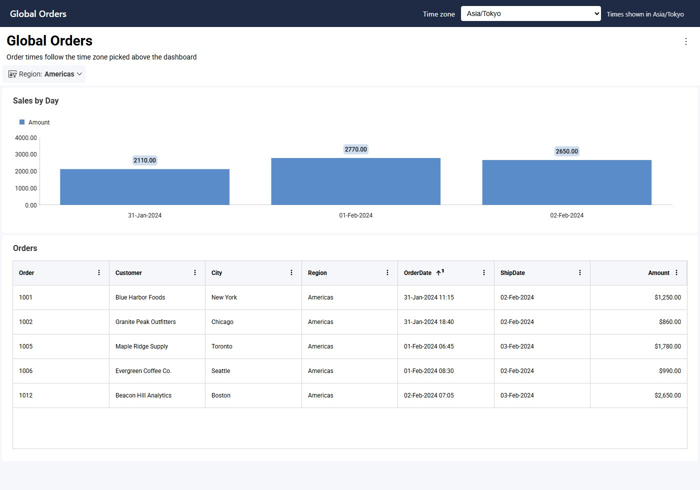
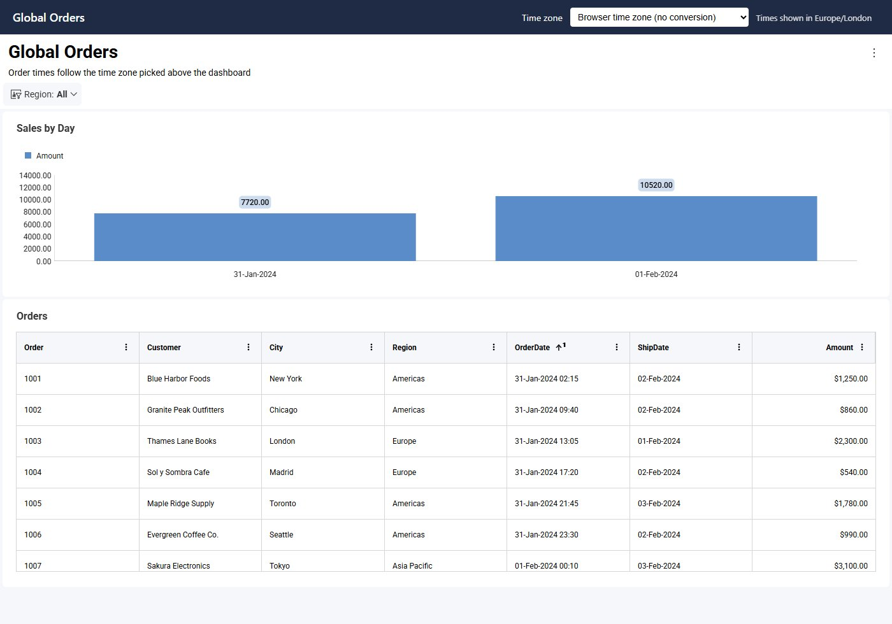
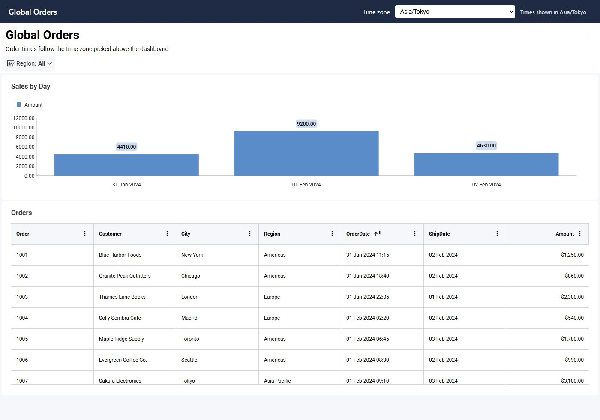

import Tabs from '@theme/Tabs';
import TabItem from '@theme/TabItem';

# Time Zones

By default, the Reveal SDK uses the browser's time zone for relative date filters such as **Today** or **This Month**, for the date pickers, and for the `currentTimeZone()` function. When your users need to see dashboards in a different time zone, for example a user whose profile says they work in New York while their laptop is set to London, set `RevealSdkSettings.timeZone`. Reveal then uses that time zone instead of the browser's, converts every DateTime value to it, and reloads any dashboard that is already open.

Reveal doesn't include a time zone picker. As with the [language](localizing.md), your application provides the UI and sets the time zone through the SDK.

:::info

The time zone API is available in Reveal SDK 2.3.0 and later. Use 2.3.0 or later on both the client and the server: the conversion happens on the server.

:::

## Setting the Time Zone

Set `RevealSdkSettings.timeZone` to a member of `RVTimeZone` or to any IANA time zone name. Set it to `null` to go back to the browser's time zone.

```js
// Use New York time instead of the browser's
RevealSdkSettings.timeZone = RVTimeZone.AmericaNewYork;

// Any IANA time zone name works too
RevealSdkSettings.timeZone = "Europe/Madrid";

// Go back to the browser's time zone, with no conversion
RevealSdkSettings.timeZone = null;
```

You can set it before creating the `RevealView`, or at any time while a dashboard is open (see [Switching the Time Zone on an Open Dashboard](#switching-the-time-zone-on-an-open-dashboard)).

The value you set decides two things: which time zone Reveal uses, and whether DateTime values are converted to it.

| Value | Time zone used | DateTime values converted |
|---|---|---|
| `null` (the default) | The browser's | No, they're shown as stored |
| `RVTimeZone.Browser` | The browser's | Yes, to the browser's time zone |
| An `RVTimeZone` member or an IANA name | That time zone | Yes, to that time zone |

`RVTimeZone.Browser` is the option for "show dates in my own time zone": it keeps the browser's time zone and turns the conversion on.

Reading `RevealSdkSettings.timeZone` returns the value you set: the time zone name, `RVTimeZone.Browser`, or `null`. The name comes back as the browser spells it, which can be an older spelling of a renamed zone (for example `Asia/Calcutta` for `Asia/Kolkata`). To get the time zone in use, whichever way it was chosen, call `RevealSdkSettings.getCurrentTimeZone()`.

```js
RevealSdkSettings.timeZone = RVTimeZone.Browser;
console.log(RevealSdkSettings.timeZone);              // "Browser"
console.log(RevealSdkSettings.getCurrentTimeZone());  // the browser's time zone, e.g. "Europe/London"
```

The time zone is set on the client. The server SDKs (ASP.NET, Java and Node.js) need no code for it: the client sends the time zone with every data request. On the server, only [exports](#exports) take a time zone of their own.

## Building the List of Time Zones

`RVTimeZone` lists the 139 most used time zones, one for each distinct UTC offset and daylight saving rule, plus `Browser`. It's the same set Windows uses, mapped to IANA names, so every member is accepted by the browser and by the server. The `Etc/GMT` members are fixed offsets with the sign inverted, as IANA defines them: `Etc/GMT+8` is UTC−8.

```js
const select = document.getElementById("timeZone");
for (const zone of Object.values(RVTimeZone)) {
    if (zone !== RVTimeZone.Browser) {
        select.add(new Option(zone.replace(/_/g, " "), zone));
    }
}
```

To offer every time zone the browser knows, use `Intl.supportedValuesOf("timeZone")` instead.

The [example at the end of this topic](#example-letting-users-pick-their-time-zone) puts the list in a selector above the dashboard, with the time zone in use next to it:


## Handling Invalid Time Zone Names

Setting a name Reveal doesn't recognize throws an error, and the previous time zone stays in use. Wrap the assignment when the name comes from user input or from a saved setting:

```js
try {
    RevealSdkSettings.timeZone = userInput;
} catch (e) {
    showError(e.message); // "Invalid time zone: ..."
}
```

In the example, a saved name that is no longer valid shows the error next to the selector, and the dashboard loads in the browser's time zone:


Use IANA names only. Windows names such as `Pacific Standard Time` are rejected. Offset strings such as `+05:30` are accepted by some browsers, but the server can't resolve them, and every visualization with DateTime fields then fails with "Unknown time zone". For a fixed offset, use the matching `Etc/GMT` member or a city in that time zone, such as `Asia/Kolkata` for UTC+5:30.

## Switching the Time Zone on an Open Dashboard

Setting `RevealSdkSettings.timeZone` while a dashboard is displayed reloads its data in place. You don't need to call anything else. The dashboard isn't rebuilt, so the user keeps:

- their filter selections
- the maximized visualization
- drill-down levels and scroll positions

Relative date filters move to the new time zone (**Today** becomes today in that zone), and open popups close. Every `RevealView` on the page reloads. Setting the value that is already in use reloads nothing.

Here the **Region** filter was set to **Americas** before switching to `Asia/Tokyo`. The filter is kept, and only the order times change:



## How DateTime Values Are Converted

While a time zone is set, the server converts every DateTime field to it before grouping, filtering, calculated fields and formatting. Dashboards and data sources don't need any changes.

- **Values without a time zone are treated as UTC.** Values that carry their own offset, such as SQL Server `datetimeoffset` or Oracle `TIMESTAMP WITH TIME ZONE`, are normalized to UTC first.
- **Only DateTime fields are converted.** Date and Time fields are never shifted, even when the DateTime on the same row moves to another day.
- **Grouping follows the time zone.** Grouping by day, week or month uses the converted values, so a sale at 23:30 UTC on January 31 counts toward February 1 in Tokyo.
- **Calculated fields are converted once.** They read fields that are already converted, so they aren't converted again.
- **`applyTimeZone()` converts again.** An `applyTimeZone()` formula over a converted field shifts it a second time. See [Upgrading Existing Dashboards](#upgrading-existing-dashboards).

For example, take an order with an `OrderDate` DateTime field stored as `2024-01-31 23:30` and a `ShipDate` Date field stored as `2024-02-02`:

| `RevealSdkSettings.timeZone` | `OrderDate` (DateTime) | `ShipDate` (Date) |
|---|---|---|
| `null` | 2024-01-31 23:30 | 2024-02-02 |
| `RVTimeZone.AmericaNewYork` | 2024-01-31 18:30 | 2024-02-02 |
| `RVTimeZone.AsiaTokyo` | 2024-02-01 08:30 | 2024-02-02 |

The dashboard below holds twelve orders placed around midnight UTC between January 31 and February 1. With no time zone set, the browser is in London, and **Sales by Day** groups the orders into two days:



With `RVTimeZone.AsiaTokyo`, every `OrderDate` moves nine hours ahead, so the same orders fall on three days. `ShipDate` doesn't change:



### Supported Data Sources

The conversion runs in Reveal's server-side data engine, which supports:

- Amazon Athena, Amazon Redshift, Azure SQL, Azure Synapse, ClickHouse, Cosmos DB, Databricks, DuckDB, Elasticsearch, Google BigQuery, MariaDB, MongoDB, MS SQL Server, MySQL, Oracle, PostgreSQL, Snowflake and SQLite
- CSV, Excel and JSON data, including files read from REST, Amazon S3, SharePoint, OneDrive, Google Drive, Dropbox, Box or local storage
- Google Sheets and in-memory data

Other data sources, such as Cube, OData, Salesforce, Dynamics 365, HubSpot, Marketo, QuickBooks, Google Analytics 4 and Reporting Services, can't be converted. While a time zone is set, visualizations over them that have DateTime fields show the error "Converting to the current time zone requires Engine2…", and so do visualizations that blend one of them with a supported data source. Keep `RevealSdkSettings.timeZone` set to `null` for dashboards that use these data sources.

## Exports

Exports started from the `RevealView` contain the values the user sees, in the time zone in use.

[Server-side exports](server-export.md) don't have a browser, so they use the `TimeZone` property of the export options. When it's set, DateTime values are converted to it, and relative date filters and `currentTimeZone()` use it. When it isn't set, the export uses UTC and converts nothing.

<Tabs groupId="code" queryString>
  <TabItem value="aspnet" label="ASP.NET" default>

```cs
var pdfOptions = new PdfExportOptions()
{
    TimeZone = "America/New_York"
};

var stream = await dashboardExporter.ExportToPdf(dashboardName, options: pdfOptions);
```

  </TabItem>

  <TabItem value="java" label="Java">

```java
PdfExportOptions options = new PdfExportOptions();
options.setTimeZone("America/New_York");

// revealServer is the IRevealServer your application built with RevealServerBuilder
IDashboardExporter exporter = revealServer.getDashboardExporter();
InputStream stream = exporter.exportToPdf(dashboardName, userContext, options).get();
```

  </TabItem>

  <TabItem value="node" label="Node.js">

```ts
import { PdfExportOptions } from "reveal-sdk-node";

const options = new PdfExportOptions();
options.timeZone = "America/New_York";

const stream = await revealServer.exporter.exportPdf(dashboardName, null, options, null);
```

  </TabItem>
</Tabs>

The same property is available on the Excel and PowerPoint export options. To export in the time zone a user picked in your application, send their choice to the server with the export request.

## Upgrading Existing Dashboards

- **Remove `applyTimeZone()` formulas that did the conversion by hand.** A dashboard that used a calculated field such as `applyTimeZone([OrderDate], currentTimeZone())` to show local times now gets `OrderDate` already converted while a time zone is set, so the formula converts it twice. Use `[OrderDate]` directly. The same applies to formulas with a fixed zone, such as `applyTimeZone([OrderDate], "Europe/Madrid")`. Dashboards keep working as before while `RevealSdkSettings.timeZone` is `null`.
- **`DisplayInLocalTimeZone` has been removed.** This field setting had no effect. Dashboards that contain it still load.

## Example: Letting Users Pick Their Time Zone

This example adds a time zone selector next to the dashboard, shows the time zone in use, remembers the user's choice, and switches the open dashboard without losing its filters. The screenshots in this topic were taken with it.

**Step 1** - Add the selector, a label for the time zone in use, and a place for errors.

```html
<select id="timeZone">
    <option value="">Browser time zone (no conversion)</option>
    <option value="Browser">Browser time zone (convert dates)</option>
</select>
<span id="currentTimeZone"></span>
<span id="timeZoneError" style="color: red"></span>
<div id="revealView" style="height: 800px; width: 100%;"></div>
```

**Step 2** - Fill the selector, apply the saved choice before the dashboard loads, and switch on change.

```js
const select = document.getElementById("timeZone");
const current = document.getElementById("currentTimeZone");
const error = document.getElementById("timeZoneError");

for (const zone of Object.values(RVTimeZone)) {
    if (zone !== RVTimeZone.Browser) {
        select.add(new Option(zone.replace(/_/g, " "), zone));
    }
}

// Sets the time zone; returns false and keeps the previous one when the name is invalid
function setTimeZone(zone) {
    let applied = true;
    try {
        RevealSdkSettings.timeZone = zone || null;
        error.textContent = "";
        select.value = zone || "";
    } catch (e) {
        error.textContent = e.message;
        applied = false;
    }
    current.textContent = `Times shown in ${RevealSdkSettings.getCurrentTimeZone()}`;
    return applied;
}

select.addEventListener("change", () => {
    // An open dashboard reloads by itself, keeping its filters
    if (setTimeZone(select.value)) {
        localStorage.setItem("timeZone", select.value);
    }
});

// Apply the saved choice before creating the RevealView
setTimeZone(localStorage.getItem("timeZone") ?? "");

RevealSdkSettings.setBaseUrl("https://localhost:5111/");
RVDashboard.loadDashboard("Sales").then(dashboard => {
    const revealView = new RevealView("#revealView");
    revealView.dashboard = dashboard;
});
```

This example keeps the choice in `localStorage`, so it only follows the user on the same browser. To follow the user across devices, save it in your application's user profile and read it from there before creating the `RevealView`. If a saved name is no longer valid, `setTimeZone` reports it and the dashboard loads in the browser's time zone.

## Limitations

- Use IANA time zone names. Offset strings such as `+05:30` fail on the server.
- The conversion is supported only for the [data sources listed above](#supported-data-sources).
- The time zone is global: every `RevealView` on the page uses the same one.
