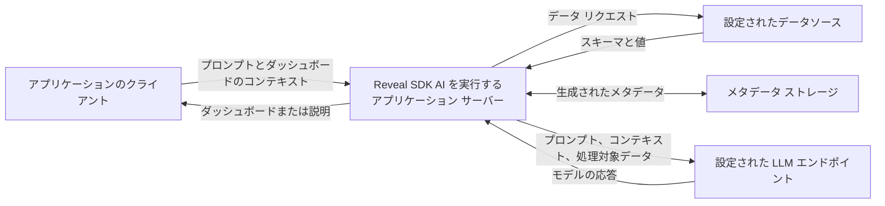

# データの取り扱い

Reveal SDK AI は、ユーザーのプロンプト、ダッシュボード情報、データソースのメタデータを処理して、ダッシュボードを生成し、質問に回答します。**メタデータには、実データの値が含まれる場合があります。** インサイトとチャットによる分析では、ビジュアライゼーションのデータと計算結果も使用します。

サーバー SDK は、アプリケーションのサーバー環境で動作します。Reveal データ エンジンを通じてデータを読み取り、AI の処理に必要な情報を準備して、設定された言語モデル プロバイダーを通じてリクエストを送信します。利用可能なデータソース、プロバイダーへの接続、およびユーザーのアクセスは、アプリケーションが制御します。

## データの流れ



組み込みのプロバイダー連携を使用する場合、AI リクエストはサーバーから設定で選択したプロバイダーのエンドポイントに送信されます。カスタム プロバイダー、ゲートウェイ、またはセルフホスト型モデルを使用すると、この経路が変わる場合があります。[AI プロバイダーとプロファイル](providers-overview.md)および[カスタム エンドポイント](providers-custom-endpoints.md)を参照してください。

## モデルに送信される情報

送信内容は処理によって異なり、複数回のモデル呼び出しに分けて送信される場合があります。1 回のチャット リクエストに、インテントの分類、ダッシュボードの生成、フィルタリング、または分析が含まれることがあります。

| 処理 | 含まれる可能性がある情報 |
|---|---|
| ダッシュボードの作成または編集 | ユーザーのメッセージ、関連する会話履歴、アプリケーションが提供するコンテキスト、データソースの識別子、テーブルとフィールドの定義、説明、エイリアス、およびリクエストに必要なダッシュボードの仕様。生成されたデータソースの説明には、サンプリングされたフィールド値が含まれる場合があります。 |
| フィルターの作成または調整 | ダッシュボードとフィルターの定義、既存の選択内容、および生成されたメタデータに含まれる利用可能なフィールド値。これらの値は、モデルが「西部地域を表示して」のようなリクエストを、データソースで使用できる値に対応付けるために役立ちます。 |
| インサイトの生成またはチャットによるデータ分析 | 選択したビジュアライゼーションまたはダッシュボードのために抽出されたデータ、書式設定された値、質問またはインサイトの生成指示、および計算結果。チャットによる分析には、会話履歴とアプリケーションが提供するコンテキストが含まれる場合もあります。 |
| AI によるメタデータの拡充 (有効な場合) | 説明やエイリアスの生成に使用する、スキーマ情報、既存の説明、フィールドの統計情報、およびフィールド値のサンプル。 |

### ダッシュボードの生成とフィルタリング

[メタデータカタログ](metadata-catalog.md)は、AI が利用できるデータソースを定義します。生成されたメタデータには、それらのデータソースから取得したフィールドの型、一意の値の数、数値の範囲、およびキャッシュされたフィルター値などの情報が追加されます。アプリケーションが提供する説明やエイリアスにも、業務情報や値の例が含まれる場合があります。

フィルター値は、フィールドごとに収集されます。SDK は、これらの値またはそのサンプルをモデルへのプロンプトに含めることがあります。サンプルのサイズと選択方法は、処理や生成経路によって異なり、リクエスト中に送信されるすべてのデータの上限を定めるものではありません。生成されたメタデータと作成したカタログの内容は、いずれも選択したモデル プロバイダーと共有される可能性があるデータとして扱ってください。

### インサイトとチャットによる分析

[インサイト](sdk-insights.md)は、Reveal データ エンジンを通じてビジュアライゼーションの結果を読み取り、サマリー、分析、または予測のために、書式設定されたデータをモデルに送信します。チャットでも、質問への回答に必要な場合は、同じ分析ワークフローを呼び出すことがあります。

データには、ビジュアライゼーションのフィールド、フィルター、および集計が反映されます。そのため、明細レコードを表示するビジュアライゼーションでは、合計値だけでなく、明細の値が提供される場合があります。分析では、取得したデータに対して計算を実行し、その結果を後続のモデル呼び出しで送信することがあります。最初のプロンプトに適用される書式設定やサンプリングの制限は、その後のすべての計算出力の上限を定めるものではありません。

### 任意のメタデータ拡充 {#optional-metadata-enrichment}

組み込みのメタデータ マネージャーでは、AI によるセマンティック エンリッチメントは既定で無効になっています。`MetadataManagerOptions.EnableSemanticEnrichment` を有効にすると、メタデータ生成時にモデルを呼び出して説明やエイリアスを改善できます。これらの呼び出しには、実際のフィールド値のサンプルが含まれる場合があります。

セマンティック エンリッチメントを無効にしても、通常のメタデータ生成によるフィールド値の読み取りやキャッシュ、またはダッシュボードやフィルターのプロンプトでのメタデータの使用は停止されません。

## 保存と会話履歴

### 生成されたメタデータ

既定のメタデータ ストレージ プロバイダーは、サーバー環境に JSON ファイルを書き込みます。これらのファイルには、スキーマの詳細、説明、統計情報、およびキャッシュされた値が含まれる場合があります。`MetadataManagerOptions.OutputPath` で出力先を設定するか、[メタデータ ストレージ プロバイダー](../metadata-storage-provider/)を使用して、永続化とアクセス可能な範囲を制御してください。

メタデータ ストレージとそのバックアップは、元のデータと同様に保護してください。適切なファイルシステムまたはストレージのアクセス許可、保存時の暗号化、および削除ポリシーを適用してください。メタデータの再生成や鮮度に関する設定によって、保持または削除のポリシーが定まるわけではありません。

### チャットの状態

組み込みのチャット状態マネージャーは、リクエスト間で会話の状態をサーバー プロセスのメモリに保持します。これには、質問、回答、ダッシュボードの各バージョン、および分析結果が含まれる場合があります。組み込みのマネージャーは、時間に基づく有効期限ポリシーを適用しません。状態は、セッションをクリアすると削除され、セッションのデータソースまたはデータベースを変更すると置き換えられ、プロセスが終了すると失われます。

`ChatManagerOptions.MaxHistoryTurns` の既定値は 20 で、プロンプトに含める直近の会話履歴の選択を制御します。ダッシュボードを含む最新のやり取りは、この範囲外でも選択されることがあります。この設定は、メモリ内のセッションから古いやり取りを削除するものではありません。一部の生成経路では、以前のダッシュボードのバージョンもコンテキストとして使用します。

現在の会話をクリアするには、[チャット API](sdk-chat.md)を使用します。

```typescript
await client.ai.chat.resetContext();
```

SDK のチャット状態をクリアしても、メタデータ ファイル、保存済みダッシュボード、アプリケーション ログ、または外部プロバイダーが保持するコピーは削除されません。それぞれに対応する削除の制御を別途適用してください。

### プロバイダーのキャッシュとログ

プロバイダー側のキャッシュは、SDK のメタデータ ストレージやチャット状態とは別のものです。OpenAI と Anthropic のアダプターでは、`PromptCaching` オプションが既定で有効になっています。その動作はモデルと API によって異なり、キャッシュされる内容には、スキーマ、コンテキスト、または会話の内容が含まれる場合があります。利用環境に適用されるキャッシュ設定とプロバイダーの利用条件を確認してください。SDK のキャッシュ オプションを無効にしても、データが一切保持されないことを保証するものではありません。

SDK は、リクエストの結果、識別子、モデルの使用状況、トークン数などの運用ログと使用量レコードを生成します。エラーの詳細やアプリケーションで定義した診断情報には、追加の情報が含まれる場合があります。アプリケーションで設定した HTTP トレース、カスタム プロバイダー、使用量シンクを含め、ログの送信先、アクセス、機密情報の除去、および保持を確認してください。

## アプリケーションとプロバイダーの責任

利用環境のデータ経路全体を設定してください。

- **リクエストの認証と認可を行います。** AI エンドポイントを保護し、ダッシュボード、データソース、メタデータ、およびプロファイルへのアクセスを制御してください。ASP.NET Core では、`RevealAI.AuthorizationPolicy` によって、アプリケーションで定義した認可ポリシーが AI エンドポイントに適用されます。
- **信頼できるユーザーとテナントのコンテキストを提供します。** サーバーで検証済みの ID 情報を使用し、データソースへのアクセスとメタデータ ストレージでテナント間の分離を徹底してください。既定の JSON メタデータ ストアは、設定された保存先で共有され、ユーザーまたはテナントに応じてメタデータをフィルターすることはありません。必要に応じて、テナントを考慮したストレージと識別子を使用してください。
- **モデル呼び出しの前に機密情報を制限します。** データソースのアクセス許可、カタログの説明、キャッシュされた値、ユーザーのプロンプト、およびカスタム コンテキストを確認してください。組み込みのプロバイダー リクエスト経路では、機密情報は自動的に除去されません。その情報を AI に提供する前に、承認済みのビュー、フィルタリング、または機密情報の除去を使用してください。
- **接続と認証情報を管理します。** プロバイダーの認証情報はサーバー側に保持し、承認済みのプロファイルとエンドポイントだけを利用可能にしてください。[インテント ルーティング](intents.md)では、処理のステップごとに異なるプロファイルが選択されることがあるため、ワークフローで使用するすべてのプロバイダーを確認してください。
- **ライフサイクルの制御を設定します。** メタデータ、チャット状態、保存済みダッシュボード、ログ、バックアップ、およびアプリケーションが管理するストレージについて、保持と削除の方針を定義してください。経路上の各サービスについて、通信のセキュリティとストレージの保護を設定してください。

モデル プロバイダーによるデータの保持、学習への使用、データの保管場所、およびアクセスのポリシーは、利用するサービス、アカウント、エンドポイント、および契約によって異なります。これらのポリシーをプロバイダーに確認し、ゲートウェイやホスティング サービスも確認の対象に含めてください。SDK の設定だけで、利用環境に対するこれらの保証が成立するわけではありません。
