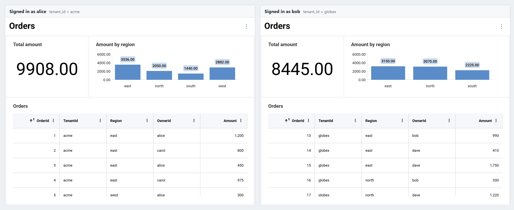
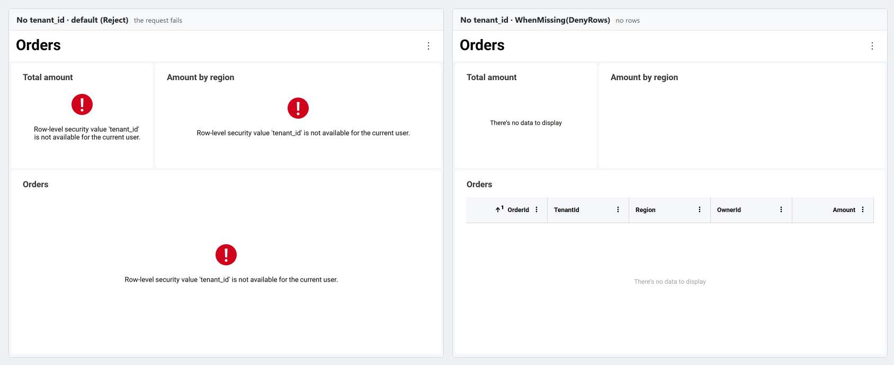

import Tabs from '@theme/Tabs';
import TabItem from '@theme/TabItem';

# 行レベル セキュリティ

行レベル セキュリティ (RLS) は、各ユーザーがデータ ソースのどの行を読み取れるかを制御します。データ ソース項目に対して、「行の `TenantId` がユーザーのテナントと等しくなければならない」などの**行フィルター**をサーバー上で定義すると、Reveal はその項目を読み取るすべてのクエリ (表示形式、合計、ダッシュボード フィルターの値、ブレンドされたデータ、エクスポート) にそのフィルターを適用します。すべてのユーザーが同じダッシュボードを開きますが、表示されるのは自分の行のみです。



## 仕組み

行フィルターは、[データ ソース プロバイダー](replacing-datasources.md)で設定します。データ ソース プロバイダーは、リクエストが読み取るすべてのデータ ソース項目に対して Reveal が呼び出すサーバー側のコールバックです。フィルターは、現在のリクエストの[ユーザー コンテキスト](user-context.md) (ユーザー ID、ロール、およびサインインしたユーザーについてサーバーが把握しているその他の値 (クレーム)) から作成されます。

- **フィルターはサーバー上に留まります。** フィルターがクライアントに送信されることはなく、クライアントが何を送信しても、フィルターを削除したり置き換えたりすることはできません。
- **フィルターはすべての集計の前に実行されます。** データベースの場合、フィルターはクエリの `WHERE` 句の一部になります。合計、ピボットの総計、フィルター値のリスト、ブレンドされたデータは、ユーザーが参照できる行のみから計算されます。
- **値はクエリ パラメーターとして送信されます。** ユーザー コンテキストの値がクエリ テキストに連結されることはないため、値によってクエリが変更されることはありません。
- **キャッシュはフィルターを考慮します。** 結果はフィルター値ごとにキャッシュされるため、あるユーザー向けに計算された結果が、フィルター値の異なるユーザーに提供されることはありません。
- **フェールクローズで動作します。** 必要な値がないなど、フィルターを適用できない場合は、フィルターされていない行を返すのではなく、リクエストが失敗します。

:::info 有効化は不要
行レベル セキュリティは、Reveal SDK 2.3.0 以降ではデフォルトで有効になっています。機能フラグや設定、追加のパッケージは必要なく、行レベル セキュリティを実行する Engine2 エンジンもデフォルトで有効です。行レベル セキュリティはすべてサーバー上で構成します。JavaScript クライアントには行レベル セキュリティの API はなく、クライアント コードを変更する必要もありません。

デフォルトで有効になっていても、既存のダッシュボードの動作は変わりません。行レベル セキュリティは行フィルターを指定したデータ ソース項目にのみ適用され、その他の項目はこれまでとまったく同じようにクエリされます。使用を開始するには、[行レベル セキュリティの設定](#行レベル-セキュリティの設定)で説明しているように、データ ソース プロバイダーで行フィルターを追加します。
:::

### 要件

- **Reveal SDK 2.3.0 以降。** 行レベル セキュリティは、バージョン 2.3.0 以降の ASP.NET、Java、Node.js サーバー SDK で使用できます。
- **Engine2。** 行フィルターは、Reveal のデータ処理エンジンである Engine2 によって適用されます。Engine2 はデフォルトで有効です (ASP.NET では `Engine2Enabled`、Java では `setEngine2Enabled`、Node.js では `engine2Enabled` オプション)。Engine2 が無効になっている場合、またはリクエストを Engine2 で実行できない場合、行フィルターを持つ項目を読み取るリクエストはすべて、"Row-level security is only available on Engine2, and this request cannot run on it" というエラーで失敗します。
- **表形式のデータ ソース項目。** 行フィルターは、表形式のデータ ソース項目のプロパティです。対象となるのは、テーブル、ビュー、カスタム クエリ、ストアド プロシージャーなどのデータベース項目と、CSV、Excel、JSON のファイル項目です。

## 行レベル セキュリティの設定

**手順 1** - フィルターに必要な値をユーザー コンテキストに格納します。

これらの値は、クライアントが送信する値からではなく、認証によってすでに確立されている ID から読み取ってください。ユーザー コンテキストの各プロパティは、フィルターが名前で読み取ることのできる値です。ロールは、定義済みの `Roles` プロパティに格納されます。

<Tabs groupId="code" queryString>
  <TabItem value="aspnet" label="ASP.NET" default>

```cs
public class UserContextProvider : IRVUserContextProvider
{
    public IRVUserContext GetUserContext(HttpContext aspnetContext)
    {
        // The signed-in user, as your authentication middleware established it
        var user = aspnetContext.User;

        var properties = new Dictionary<string, object>
        {
            ["tenant_id"] = user.FindFirstValue("tenant_id"),
            ["regions"] = user.FindAll("region").Select(c => c.Value).ToArray(),
        };

        return new RVUserContext(user.FindFirstValue(ClaimTypes.NameIdentifier), properties)
        {
            Roles = user.FindAll(ClaimTypes.Role).Select(c => c.Value).ToArray()
        };
    }
}
```

  </TabItem>

  <TabItem value="java" label="Java">

```java
public class UserContextProvider extends RVContainerRequestAwareUserContextProvider {
    @Override
    protected IRVUserContext getUserContext(ContainerRequestContext requestContext) {
        // The signed-in user, as your authentication layer established it; AppUser is your own user model
        AppUser user = users.find(requestContext.getSecurityContext().getUserPrincipal().getName());

        RVUserContext userContext = new RVUserContext(user.getId());
        userContext.setClaim("tenant_id", user.getTenantId());
        userContext.setClaim("regions", user.getRegions()); // a List<String>
        userContext.setRoles(user.getRoles());              // a String[]
        return userContext;
    }
}
```

  </TabItem>

  <TabItem value="node" label="Node.js">

```js
const userContextProvider = (request) => {
  // The signed-in user, as your authentication middleware established it
  const user = request.user;

  const userContext = new reveal.RVUserContext(user.id, new Map());
  userContext.setClaim("tenant_id", user.tenantId);
  userContext.setClaim("regions", user.regions); // an array of strings
  userContext.roles = user.roles;
  return userContext;
};
```

  </TabItem>

  <TabItem value="node-ts" label="Node.js - TS">

```ts
const userContextProvider = (request: IncomingMessage) => {
  // The signed-in user, as your authentication middleware established it
  const user = (request as any).user;

  const userContext = new RVUserContext(user.id, new Map<string, Object>());
  userContext.setClaim("tenant_id", user.tenantId);
  userContext.setClaim("regions", user.regions); // an array of strings
  userContext.roles = user.roles;
  return userContext;
};
```

  </TabItem>
</Tabs>

値には、文字列、数値、ブール値、日付を指定できます。後述の複数値フィルターでは、これらのコレクションを指定することもできます。`UserId` という名前は予約されています。`UserId` を読み取るフィルターは、常にユーザー コンテキストのユーザー ID を取得します。

:::danger
`setAdditionalHeadersProvider` で設定したヘッダーなど、この目的のためにクライアントが送信する値からユーザー コンテキストを設定しないでください。これらの値はブラウザーで誰でも変更でき、他のユーザーの行を読み取ることができてしまいます。認証 Cookie、検証済みのトークン、独自のセッション ストアなど、サーバーが検証した ID を使用してください。
:::

**手順 2** - データ ソース プロバイダーで、データ ソース項目に行フィルターを設定します。

プロバイダーが受け取るデータ ソース項目は、クライアントから送信されたものです。フィルターを設定する前に、データベース項目のテーブル、スキーマ、カスタム クエリ、ストアド プロシージャーなど、項目が読み取る内容を決定するすべてのプロパティを、サーバー側の値を使用して設定します。アプリケーションが提供しない項目に対しては、例外をスローしてください。`null` を返すと、項目はクライアントが送信したとおりのまま保持されます。

<Tabs groupId="code" queryString>
  <TabItem value="aspnet" label="ASP.NET" default>

```cs
public class DataSourceProvider : IRVDataSourceProvider
{
    private static readonly string[] Tables = { "Orders", "Customers" };

    public async Task<RVDataSourceItem> ChangeDataSourceItemAsync(IRVUserContext userContext, string dashboardId, RVDataSourceItem dataSourceItem)
    {
        await ChangeDataSourceAsync(userContext, dataSourceItem.DataSource);

        if (dataSourceItem is RVSqlServerDataSourceItem sqlItem)
        {
            // Decide on the server what the item reads
            var table = Tables.FirstOrDefault(t => string.Equals(t, sqlItem.Table, StringComparison.OrdinalIgnoreCase))
                ?? throw new InvalidOperationException($"Table '{sqlItem.Table}' is not available.");
            sqlItem.Schema = "dbo";
            sqlItem.Table = table;
            sqlItem.CustomQuery = null;
            sqlItem.Procedure = null;

            // Every row the user reads from the table must belong to their tenant
            sqlItem.RowFilter = RowFilter.FieldEqualsContext("TenantId", "tenant_id");
        }
        return dataSourceItem;
    }

    public Task<RVDashboardDataSource> ChangeDataSourceAsync(IRVUserContext userContext, RVDashboardDataSource dataSource)
    {
        if (dataSource is RVSqlServerDataSource sqlServer)
        {
            sqlServer.Host = "your-server";
            sqlServer.Database = "Sales";
        }
        return Task.FromResult(dataSource);
    }
}
```

  </TabItem>

  <TabItem value="java" label="Java">

```java
public class DataSourceProvider implements IRVDataSourceProvider {
    private static final List<String> TABLES = List.of("Orders", "Customers");

    public RVDataSourceItem changeDataSourceItem(IRVUserContext userContext, String dashboardId, RVDataSourceItem dataSourceItem) {
        changeDataSource(userContext, dataSourceItem.getDataSource());

        if (dataSourceItem instanceof RVSqlServerDataSourceItem sqlItem) {
            // Decide on the server what the item reads
            String table = TABLES.stream()
                .filter(t -> t.equalsIgnoreCase(sqlItem.getTable()))
                .findFirst()
                .orElseThrow(() -> new IllegalArgumentException("Table '" + sqlItem.getTable() + "' is not available."));
            sqlItem.setSchema("dbo");
            sqlItem.setTable(table);
            sqlItem.setCustomQuery(null);
            sqlItem.setProcedure(null);

            // Every row the user reads from the table must belong to their tenant
            sqlItem.setRowFilter(RowFilter.fieldEqualsContext("TenantId", "tenant_id"));
        }
        return dataSourceItem;
    }

    public RVDashboardDataSource changeDataSource(IRVUserContext userContext, RVDashboardDataSource dataSource) {
        if (dataSource instanceof RVSqlServerDataSource sqlServer) {
            sqlServer.setHost("your-server");
            sqlServer.setDatabase("Sales");
        }
        return dataSource;
    }
}
```

  </TabItem>

  <TabItem value="node" label="Node.js">

```js
const TABLES = ["Orders", "Customers"];

const dataSourceItemProvider = async (userContext, dataSourceItem) => {
  await dataSourceProvider(userContext, dataSourceItem.dataSource);

  if (dataSourceItem instanceof reveal.RVSqlServerDataSourceItem) {
    // Decide on the server what the item reads
    const table = TABLES.find(t => t.toLowerCase() === String(dataSourceItem.table).toLowerCase());
    if (!table) {
      throw new Error(`Table '${dataSourceItem.table}' is not available.`);
    }
    dataSourceItem.schema = "dbo";
    dataSourceItem.table = table;
    dataSourceItem.customQuery = null;
    dataSourceItem.procedure = null;

    // Every row the user reads from the table must belong to their tenant
    dataSourceItem.rowFilter = reveal.RowFilter.fieldEqualsContext("TenantId", "tenant_id");
  }
  return dataSourceItem;
};

const dataSourceProvider = async (userContext, dataSource) => {
  if (dataSource instanceof reveal.RVSqlServerDataSource) {
    dataSource.host = "your-server";
    dataSource.database = "Sales";
  }
  return dataSource;
};
```

  </TabItem>

  <TabItem value="node-ts" label="Node.js - TS">

```ts
const TABLES = ["Orders", "Customers"];

const dataSourceItemProvider = async (userContext: IRVUserContext | null, dataSourceItem: RVDataSourceItem) => {
  await dataSourceProvider(userContext, dataSourceItem.dataSource);

  if (dataSourceItem instanceof RVSqlServerDataSourceItem) {
    // Decide on the server what the item reads
    const table = TABLES.find(t => t.toLowerCase() === String(dataSourceItem.table).toLowerCase());
    if (!table) {
      throw new Error(`Table '${dataSourceItem.table}' is not available.`);
    }
    dataSourceItem.schema = "dbo";
    dataSourceItem.table = table;
    dataSourceItem.customQuery = null;
    dataSourceItem.procedure = null;

    // Every row the user reads from the table must belong to their tenant
    dataSourceItem.rowFilter = RowFilter.fieldEqualsContext("TenantId", "tenant_id");
  }
  return dataSourceItem;
};

const dataSourceProvider = async (userContext: IRVUserContext | null, dataSource: RVDashboardDataSource) => {
  if (dataSource instanceof RVSqlServerDataSource) {
    dataSource.host = "your-server";
    dataSource.database = "Sales";
  }
  return dataSource;
};
```

  </TabItem>
</Tabs>

**手順 3** - 両方のプロバイダーを Reveal SDK に登録します。

<Tabs groupId="code" queryString>
  <TabItem value="aspnet" label="ASP.NET" default>

```cs
builder.Services.AddControllers().AddReveal(builder =>
{
    builder.AddUserContextProvider<UserContextProvider>();
    builder.AddDataSourceProvider<DataSourceProvider>();
});
```

  </TabItem>

  <TabItem value="java" label="Java">

```java
new RevealServerBuilder()
    .setUserContextProvider(new UserContextProvider())
    .setDataSourceProvider(new DataSourceProvider())
    .build();
```

  </TabItem>

  <TabItem value="node" label="Node.js">

```js
const revealOptions = {
  userContextProvider: userContextProvider,
  dataSourceProvider: dataSourceProvider,
  dataSourceItemProvider: dataSourceItemProvider,
};
app.use('/', reveal(revealOptions));
```

  </TabItem>

  <TabItem value="node-ts" label="Node.js - TS">

```ts
const revealOptions: RevealOptions = {
  userContextProvider: userContextProvider,
  dataSourceProvider: dataSourceProvider,
  dataSourceItemProvider: dataSourceItemProvider,
};
app.use('/', reveal(revealOptions));
```

  </TabItem>
</Tabs>

行フィルターのクラスは、ASP.NET では `Reveal.Sdk.Data` 名前空間、Java では `io.revealbi.core.data` パッケージにあり、Node.js では `reveal-sdk-node` からエクスポートされます。

## 行フィルターの種類

| フィルター | 保持される行 |
| --- | --- |
| `FieldEqualsContext(field, name)` | フィールドがユーザー コンテキストの値 `name` と等しい行。 |
| `FieldInContext(field, name)` | フィールドが、コレクションであるユーザー コンテキストの値 `name` のいずれかの値と一致する行。単一の値は、要素が 1 つのコレクションとして扱われます。 |
| `FieldEqualsValue(field, value)` | フィールドが固定値と等しい行。 |
| `FieldInValues(field, values...)` | フィールドが複数の固定値のいずれかと一致する行。 |
| `All(filters...)` | すべてのフィルターが成立する行 (AND)。 |
| `Any(filters...)` | 少なくとも 1 つのフィルターが成立する行 (OR)。 |
| `Expression(expression, parameters)` | ダッシュボードの式言語で記述した条件が成立する行。 |

Java と Node.js では、名前は小文字で始まります (`fieldEqualsContext`、`all`、`expression` など)。フィールドはデータ ソースでの名前で指定し、名前の大文字と小文字は区別されます。フィールドがダッシュボードやその表示形式に含まれている必要はありません。Reveal はデータ ソースからフィールドを読み取ります。

<Tabs groupId="code" queryString>
  <TabItem value="aspnet" label="ASP.NET" default>

```cs
// The row's OwnerId is the user's id
RowFilter.FieldEqualsContext("OwnerId", "UserId");

// The row's Region is one of the user's regions
RowFilter.FieldInContext("Region", "regions");

// Fixed values
RowFilter.FieldEqualsValue("Status", "Active");
RowFilter.FieldInValues("Country", "UY", "AR", "BR");

// The user's tenant, and either one of the user's regions or a row the user owns
RowFilter.All(
    RowFilter.FieldEqualsContext("TenantId", "tenant_id"),
    RowFilter.Any(
        RowFilter.FieldInContext("Region", "regions").WhenMissing(RowFilterMissing.DenyRows),
        RowFilter.FieldEqualsContext("OwnerId", "UserId")));

// An expression, with a value of its own
RowFilter.Expression(
    "AND([TenantId] = VARIABLE(\"tenant_id\"), [Discount] < VARIABLE(\"max_discount\"))",
    new Dictionary<string, object> { ["max_discount"] = 0.25 });
```

  </TabItem>

  <TabItem value="java" label="Java">

```java
// The row's OwnerId is the user's id
RowFilter.fieldEqualsContext("OwnerId", "UserId");

// The row's Region is one of the user's regions
RowFilter.fieldInContext("Region", "regions");

// Fixed values
RowFilter.fieldEqualsValue("Status", "Active");
RowFilter.fieldInValues("Country", "UY", "AR", "BR");

// The user's tenant, and either one of the user's regions or a row the user owns
RowFilter.all(
    RowFilter.fieldEqualsContext("TenantId", "tenant_id"),
    RowFilter.any(
        RowFilter.fieldInContext("Region", "regions").whenMissing(RowFilterMissing.DENY_ROWS),
        RowFilter.fieldEqualsContext("OwnerId", "UserId")));

// An expression, with a value of its own
RowFilter.expression(
    "AND([TenantId] = VARIABLE(\"tenant_id\"), [Discount] < VARIABLE(\"max_discount\"))",
    Map.of("max_discount", 0.25));
```

  </TabItem>

  <TabItem value="node" label="Node.js">

```js
// The row's OwnerId is the user's id
reveal.RowFilter.fieldEqualsContext("OwnerId", "UserId");

// The row's Region is one of the user's regions
reveal.RowFilter.fieldInContext("Region", "regions");

// Fixed values
reveal.RowFilter.fieldEqualsValue("Status", "Active");
reveal.RowFilter.fieldInValues("Country", "UY", "AR", "BR");

// The user's tenant, and either one of the user's regions or a row the user owns
reveal.RowFilter.all(
  reveal.RowFilter.fieldEqualsContext("TenantId", "tenant_id"),
  reveal.RowFilter.any(
    reveal.RowFilter.fieldInContext("Region", "regions").whenMissing(reveal.RowFilterMissing.DenyRows),
    reveal.RowFilter.fieldEqualsContext("OwnerId", "UserId")));

// An expression, with a value of its own
reveal.RowFilter.expression(
  'AND([TenantId] = VARIABLE("tenant_id"), [Discount] < VARIABLE("max_discount"))',
  { max_discount: 0.25 });
```

  </TabItem>

  <TabItem value="node-ts" label="Node.js - TS">

```ts
// The row's OwnerId is the user's id
RowFilter.fieldEqualsContext("OwnerId", "UserId");

// The row's Region is one of the user's regions
RowFilter.fieldInContext("Region", "regions");

// Fixed values
RowFilter.fieldEqualsValue("Status", "Active");
RowFilter.fieldInValues("Country", "UY", "AR", "BR");

// The user's tenant, and either one of the user's regions or a row the user owns
RowFilter.all(
  RowFilter.fieldEqualsContext("TenantId", "tenant_id"),
  RowFilter.any(
    RowFilter.fieldInContext("Region", "regions").whenMissing(RowFilterMissing.DenyRows),
    RowFilter.fieldEqualsContext("OwnerId", "UserId")));

// An expression, with a value of its own
RowFilter.expression(
  'AND([TenantId] = VARIABLE("tenant_id"), [Discount] < VARIABLE("max_discount"))',
  { max_discount: 0.25 });
```

  </TabItem>
</Tabs>

フィルターは不変です。`ExemptRoles` と `WhenMissing` は新しいフィルターを返すため、フィルターを一度作成すれば、すべてのリクエストで再利用できます。

### 式フィルター

式フィルターでは、[計算フィールド](../user/fields/calculated/overview.md)と同じ言語を使用します。各 `VARIABLE("name")` は、まず式自体のパラメーターから値を読み取り、次にユーザー コンテキストから読み取ります。ユーザー コンテキストでは、`UserId` はユーザー ID を表します。以下の点に注意してください。

- 値のない変数があると、リクエストは失敗します。他のフィルターとは異なり、式フィルターでは代わりに行を拒否することはできません。
- 変数名の大文字と小文字は区別されます。また、`_ig_rv_` で始まる名前は予約されています。
- `SUM` などの集計関数は使用できません。
- 式フィルターを `All` や `Any` と組み合わせることはできません。代わりに、式の中で `AND` と `OR` を使用して条件を組み合わせてください。
- `TODAY()` や `NOW()` などの時間関数はクライアントが送信するタイム ゾーンを使用するため、これらの関数で指定した境界は最大で 1 日ずれる可能性があります。代わりに、日付をパラメーターとして渡してください。

## ロールの除外

`ExemptRoles` は、指定したロールのいずれかを持つユーザーに対してフィルターを解除します。ロールはユーザー コンテキストの `Roles` プロパティから読み取られ、大文字と小文字を区別して比較されます。

<Tabs groupId="code" queryString>
  <TabItem value="aspnet" label="ASP.NET" default>

```cs
// Administrators and auditors see every tenant
RowFilter.FieldEqualsContext("TenantId", "tenant_id").ExemptRoles("admin", "auditor");
```

  </TabItem>

  <TabItem value="java" label="Java">

```java
// Administrators and auditors see every tenant
RowFilter.fieldEqualsContext("TenantId", "tenant_id").exemptRoles("admin", "auditor");
```

  </TabItem>

  <TabItem value="node" label="Node.js">

```js
// Administrators and auditors see every tenant
reveal.RowFilter.fieldEqualsContext("TenantId", "tenant_id").exemptRoles("admin", "auditor");
```

  </TabItem>

  <TabItem value="node-ts" label="Node.js - TS">

```ts
// Administrators and auditors see every tenant
RowFilter.fieldEqualsContext("TenantId", "tenant_id").exemptRoles("admin", "auditor");
```

  </TabItem>
</Tabs>

`Roles` プロパティには、文字列のコレクションを格納する必要があります。単一の文字列など、それ以外の値が格納されている場合、ロールを除外するフィルターによってリクエストが失敗します。

## ユーザー コンテキストの値がない場合

デフォルトでは、現在のユーザーが持っていないユーザー コンテキストの値を読み取るフィルターは、リクエストを**拒否**します。この場合、表示形式にはデータではなくエラーが表示されます。代わりに行を表示しないようにするには、`WhenMissing` に `DenyRows` を指定します。

<Tabs groupId="code" queryString>
  <TabItem value="aspnet" label="ASP.NET" default>

```cs
RowFilter.FieldEqualsContext("TenantId", "tenant_id").WhenMissing(RowFilterMissing.DenyRows);
```

  </TabItem>

  <TabItem value="java" label="Java">

```java
RowFilter.fieldEqualsContext("TenantId", "tenant_id").whenMissing(RowFilterMissing.DENY_ROWS);
```

  </TabItem>

  <TabItem value="node" label="Node.js">

```js
reveal.RowFilter.fieldEqualsContext("TenantId", "tenant_id").whenMissing(reveal.RowFilterMissing.DenyRows);
```

  </TabItem>

  <TabItem value="node-ts" label="Node.js - TS">

```ts
RowFilter.fieldEqualsContext("TenantId", "tenant_id").whenMissing(RowFilterMissing.DenyRows);
```

  </TabItem>
</Tabs>



- ユーザー コンテキストにそのプロパティがない場合、またはプロパティの値が `null` か空のコレクションである場合、値はないものと見なされます。`UserId` は、ユーザー ID が空の場合にないものと見なされます。
- 空の文字列は値であり、値がないものとは見なされません。`tenant_id` が `""` のユーザーには、`TenantId` が空の行が表示されます。値を持たないユーザーについては、プロパティを省略してください。
- `Any` の中では、`DenyRows` を指定したフィルターはその行を許可しないだけで、他のフィルターは引き続き適用されます。前述の例で、リージョンを持たないユーザーでも自分が所有する行を参照できるのは、このためです。

## ファイル データ ソースの保護

CSV、Excel、JSON のデータ ソース項目は、ローカル ファイル項目などの**リソース項目**を介してファイルを読み取ります。CSV 項目の行フィルターではファイル自体は保護されないため、リソース項目にも `RawAccessForbidden` を設定する必要があります。これにより、Reveal はファイルのダウンロードや JSON 構造の参照など、ファイルをそのまま読み取るリクエストをすべて拒否し、フィルターされた項目を介してのみファイルを読み取ります。行フィルターを持つ項目のリソース項目に `RawAccessForbidden` が設定されていない場合、その項目へのリクエストは失敗します。

フィルターは、リソース項目ではなく、ファイルを読み取る項目に設定します。プロバイダーはリソース項目を、単独で受け取る場合と、それを読み取る項目の中に含まれた状態で受け取る場合があります。以下のように、リソース項目に対してプロバイダーを呼び出して、どちらの場合も同じように処理してください。

<Tabs groupId="code" queryString>
  <TabItem value="aspnet" label="ASP.NET" default>

```cs
public async Task<RVDataSourceItem> ChangeDataSourceItemAsync(IRVUserContext userContext, string dashboardId, RVDataSourceItem dataSourceItem)
{
    await ChangeDataSourceAsync(userContext, dataSourceItem.DataSource);

    if (dataSourceItem is RVResourceBasedDataSourceItem fileItem)
    {
        // A CSV, Excel or JSON item: change its resource item the same way, then filter the rows it reads
        await ChangeDataSourceItemAsync(userContext, dashboardId, (RVDataSourceItem)fileItem.ResourceItem);
        fileItem.RowFilter = RowFilter.FieldEqualsContext("TenantId", "tenant_id");
    }
    else if (dataSourceItem is RVLocalFileDataSourceItem file)
    {
        // The file holds every tenant's rows: never serve it as it is
        file.Uri = MapFile(file.Uri); // your own mapping to the files you serve; throws for any other
        file.RawAccessForbidden = true;
    }
    return dataSourceItem;
}
```

  </TabItem>

  <TabItem value="java" label="Java">

```java
public RVDataSourceItem changeDataSourceItem(IRVUserContext userContext, String dashboardId, RVDataSourceItem dataSourceItem) {
    changeDataSource(userContext, dataSourceItem.getDataSource());

    if (dataSourceItem instanceof RVResourceBasedDataSourceItem fileItem) {
        // A CSV, Excel or JSON item: change its resource item the same way, then filter the rows it reads
        changeDataSourceItem(userContext, dashboardId, (RVDataSourceItem) fileItem.getResourceItem());
        fileItem.setRowFilter(RowFilter.fieldEqualsContext("TenantId", "tenant_id"));
    } else if (dataSourceItem instanceof RVLocalFileDataSourceItem file) {
        // The file holds every tenant's rows: never serve it as it is
        file.setUri(mapFile(file.getUri())); // your own mapping to the files you serve; throws for any other
        file.setRawAccessForbidden(true);
    }
    return dataSourceItem;
}
```

  </TabItem>

  <TabItem value="node" label="Node.js">

```js
const dataSourceItemProvider = async (userContext, dataSourceItem) => {
  await dataSourceProvider(userContext, dataSourceItem.dataSource);

  if (dataSourceItem instanceof reveal.RVResourceBasedDataSourceItem) {
    // A CSV, Excel or JSON item: change its resource item the same way, then filter the rows it reads
    await dataSourceItemProvider(userContext, dataSourceItem.resourceItem);
    dataSourceItem.rowFilter = reveal.RowFilter.fieldEqualsContext("TenantId", "tenant_id");
  } else if (dataSourceItem instanceof reveal.RVLocalFileDataSourceItem) {
    // The file holds every tenant's rows: never serve it as it is
    dataSourceItem.uri = mapFile(dataSourceItem.uri); // your own mapping to the files you serve; throws for any other
    dataSourceItem.rawAccessForbidden = true;
  }
  return dataSourceItem;
};
```

  </TabItem>

  <TabItem value="node-ts" label="Node.js - TS">

```ts
const dataSourceItemProvider = async (userContext: IRVUserContext | null, dataSourceItem: RVDataSourceItem): Promise<RVDataSourceItem> => {
  await dataSourceProvider(userContext, dataSourceItem.dataSource);

  if (dataSourceItem instanceof RVResourceBasedDataSourceItem) {
    // A CSV, Excel or JSON item: change its resource item the same way, then filter the rows it reads
    await dataSourceItemProvider(userContext, dataSourceItem.resourceItem as RVDataSourceItem);
    dataSourceItem.rowFilter = RowFilter.fieldEqualsContext("TenantId", "tenant_id");
  } else if (dataSourceItem instanceof RVLocalFileDataSourceItem) {
    // The file holds every tenant's rows: never serve it as it is
    dataSourceItem.uri = mapFile(dataSourceItem.uri); // your own mapping to the files you serve; throws for any other
    dataSourceItem.rawAccessForbidden = true;
  }
  return dataSourceItem;
};
```

  </TabItem>
</Tabs>

Excel 項目の場合はシートと範囲を、JSON 項目の場合は列の構成も、サーバー上で設定してください。データベース項目のテーブルと同様に、これらの設定によって、フィールド名がどの列を指すかが決まります。

## サーバーでのダッシュボードのエクスポート

[サーバーでダッシュボードをエクスポートする](server-export.md)場合は、[ユーザー コンテキストの提供](server-export.md#ユーザー-コンテキストの提供)で説明しているように、エクスポート メソッドにユーザー コンテキストを渡します。これにより、エクスポートにはそのユーザーが参照するのと同じ行が含まれます。ユーザー コンテキストを渡さない場合、フィルターがユーザー コンテキストから読み取る値はすべてないものと見なされます。その結果、エクスポートは失敗するか、`DenyRows` を使用するフィルターの場合は行が含まれません。

## ベスト プラクティス

- **すべてをサーバー上で決定します。** 項目が読み取る内容を決定するプロパティを設定し、提供しない項目に対しては例外をスローします。テーブル名やファイル パスなど、リクエストに含まれる値は、まず独自の値にマッピングしてから判断に使用してください。
- **値の型を列の型に合わせます。** テキスト列には文字列を、数値列には数値をユーザー コンテキストに格納します。型の異なる値はどの行とも一致しない可能性があり、変換に失敗すると、ユーザーが参照できない行の値を含むデータベース エラーが発生する可能性があります。
- **データベースでの値の比較方法を把握します。** フィルターは、データ ソースの規則に従ってデータ ソース内で値を比較します。SQL Server と MySQL のデフォルトの照合順序では、`'acme'` は `'ACME'` や `'acme '` とも一致します。ファイル データ ソースでは、値は完全一致で比較されます。大文字と小文字や末尾のスペースのみが異なるキーは使用しないでください。
- **値のリストを短く保ちます。** `FieldInContext` と `FieldInValues` は、値が約 1,000 個を超えると失敗する可能性があり、SQL Server では 1 つのクエリで使用できるパラメーターは最大 2,100 個です。大規模な権限リストの場合は、代わりに行をグループ化する列でフィルターするか、データを権限テーブルと結合するビューを公開し、そのビューを `UserId` でフィルターしてください。
- **データ ソース プロバイダーを高速に保ちます。** データ ソース プロバイダーは、すべてのデータ リクエストで実行されます。ユーザーの権限など、プロバイダーで必要な検索結果はキャッシュしてください。

## 制限事項

- **計算フィールド。** フィルターは物理フィールドのみを読み取ります。フィルターが読み取るフィールドと同じ名前の計算フィールドを宣言するリクエストは拒否されるため、そのような計算フィールドの名前を変更してください。
- **スキーマの変更。** Reveal は、フィルターされた項目を読み取るすべてのリクエストをデータ ソースのスキーマと照合し、そのスキーマをサーバー上にキャッシュします。フィルター対象の列のデータ型が変更された場合、サーバーのキャッシュされたスキーマがクリアされ (サーバーの再起動など)、変更前に保存されたダッシュボードが更新されるまで、それらのリクエストは失敗します。ダッシュボードを更新するには、ダッシュボード エディターでデータ ソースのフィールドを更新してから、ダッシュボードを保存します。ダッシュボードの保存後にデータ ソースに追加されたフィルター対象の列については、変更は必要ありません。
- **ストアド プロシージャー。** ストアド プロシージャーが返す行は、データベースではなく、プロシージャーの実行後に Reveal によってフィルターされます。プロシージャーが多数の行を返す場合は、ユーザーの値をプロシージャーのパラメーターとしても渡してください。
- **サーバー側のデータ ソース。** サーバー側のデータ ソースが有効になっている場合 (`ServerSideDataSourcesEnabled`)、行フィルターはサポートされません。

## 関連トピック

- [ユーザー コンテキスト](user-context.md)
- [データ ソースの置き換え](replacing-datasources.md)
- [カスタム クエリ](custom-queries.md)
- [サーバーのエクスポート](server-export.md)
