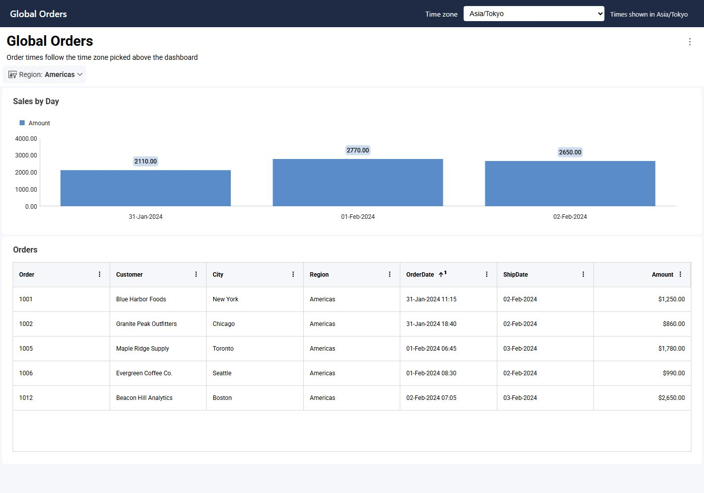
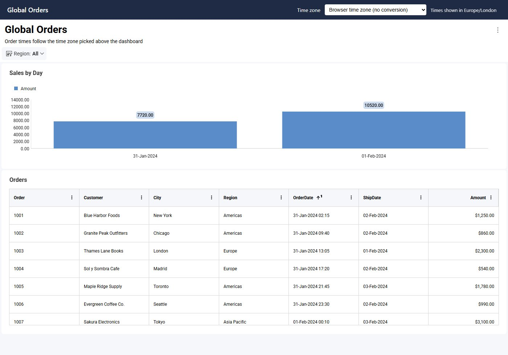
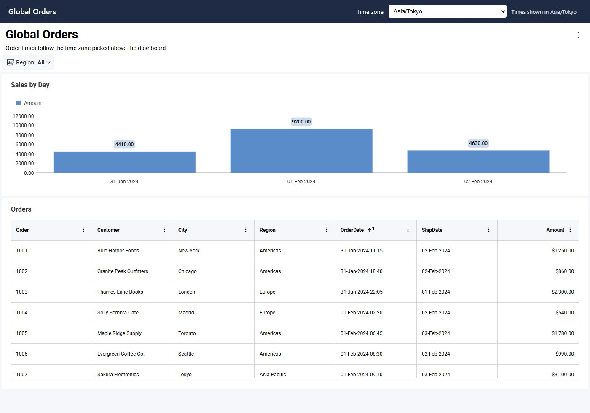

import Tabs from '@theme/Tabs';
import TabItem from '@theme/TabItem';

# タイムゾーン

Reveal SDK はデフォルトで、**今日**や**今月**などの相対日付フィルター、日付ピッカー、および `currentTimeZone()` 関数にブラウザーのタイムゾーンを使用します。ユーザーが異なるタイムゾーンでダッシュボードを表示する必要がある場合 (たとえば、プロファイル上はニューヨークで勤務しているものの、ノート PC がロンドンに設定されているユーザーの場合)、`RevealSdkSettings.timeZone` を設定します。Reveal はブラウザーのタイムゾーンの代わりにそのタイムゾーンを使用し、すべての DateTime 値をそのタイムゾーンに変換して、すでに開いているダッシュボードを再読み込みします。

Reveal にはタイムゾーン ピッカーは含まれていません。[言語](localizing.md)と同様に、アプリケーションが UI を提供し、SDK を通じてタイムゾーンを設定します。

:::info

タイムゾーン API は Reveal SDK 2.3.0 以降で利用できます。変換はサーバーで行われるため、クライアントとサーバーの両方で 2.3.0 以降を使用してください。

:::

## タイムゾーンの設定 {#setting-the-time-zone}

`RevealSdkSettings.timeZone` に `RVTimeZone` のメンバーまたは任意の IANA タイムゾーン名を設定します。ブラウザーのタイムゾーンに戻すには `null` を設定します。

```js
// Use New York time instead of the browser's
RevealSdkSettings.timeZone = RVTimeZone.AmericaNewYork;

// Any IANA time zone name works too
RevealSdkSettings.timeZone = "Europe/Madrid";

// Go back to the browser's time zone, with no conversion
RevealSdkSettings.timeZone = null;
```

`RevealView` を作成する前に設定することも、ダッシュボードを開いている間にいつでも設定することもできます ([開いているダッシュボードでのタイムゾーンの切り替え](#switching-the-time-zone-on-an-open-dashboard)を参照してください)。

設定した値によって、使用されるタイムゾーンと、DateTime 値をそのタイムゾーンに変換するかどうかの 2 点が決まります。

| 値 | 使用されるタイムゾーン | DateTime 値の変換 |
|---|---|---|
| `null` (デフォルト) | ブラウザーのタイムゾーン | なし (保存されている値のまま表示) |
| `RVTimeZone.Browser` | ブラウザーのタイムゾーン | あり (ブラウザーのタイムゾーンに変換) |
| `RVTimeZone` のメンバーまたは IANA 名 | 指定したタイムゾーン | あり (指定したタイムゾーンに変換) |

`RVTimeZone.Browser` は、「日付を自分のタイムゾーンで表示する」ためのオプションです。ブラウザーのタイムゾーンを維持したまま、変換を有効にします。

`RevealSdkSettings.timeZone` を読み取ると、設定した値 (タイムゾーン名、`RVTimeZone.Browser`、または `null`) が返されます。名前はブラウザーの表記で返されるため、名前が変更されたタイムゾーンでは古い表記になる場合があります (たとえば、`Asia/Kolkata` が `Asia/Calcutta` として返されます)。どの方法で選択されたかにかかわらず、使用中のタイムゾーンを取得するには `RevealSdkSettings.getCurrentTimeZone()` を呼び出します。

```js
RevealSdkSettings.timeZone = RVTimeZone.Browser;
console.log(RevealSdkSettings.timeZone);              // "Browser"
console.log(RevealSdkSettings.getCurrentTimeZone());  // the browser's time zone, e.g. "Europe/London"
```

タイムゾーンはクライアントで設定します。クライアントがすべてのデータ リクエストとともにタイムゾーンを送信するため、サーバー SDK (ASP.NET、Java、Node.js) ではタイムゾーン用のコードは必要ありません。サーバー側で独自のタイムゾーンを指定するのは[エクスポート](#exports)のみです。

## タイムゾーン リストの作成 {#building-the-list-of-time-zones}

`RVTimeZone` には、よく使用される 139 のタイムゾーン (UTC オフセットと夏時間ルールの組み合わせごとに 1 つ) と `Browser` が含まれています。これは Windows で使用されているものと同じセットを IANA 名に対応付けたものであるため、すべてのメンバーがブラウザーとサーバーの両方で受け入れられます。`Etc/GMT` のメンバーは、IANA の定義どおり符号が反転した固定オフセットです。たとえば、`Etc/GMT+8` は UTC−8 を表します。

```js
const select = document.getElementById("timeZone");
for (const zone of Object.values(RVTimeZone)) {
    if (zone !== RVTimeZone.Browser) {
        select.add(new Option(zone.replace(/_/g, " "), zone));
    }
}
```

ブラウザーが認識するすべてのタイムゾーンを選択肢として提供するには、代わりに `Intl.supportedValuesOf("timeZone")` を使用します。

[このトピックの最後にある例](#example-letting-users-pick-their-time-zone)では、ダッシュボードの上にあるセレクターにリストを表示し、その横に使用中のタイムゾーンを表示します。


## 無効なタイムゾーン名の処理 {#handling-invalid-time-zone-names}

Reveal が認識できない名前を設定するとエラーがスローされ、以前のタイムゾーンが引き続き使用されます。名前をユーザー入力や保存された設定から取得する場合は、代入を `try` ブロックで囲みます。

```js
try {
    RevealSdkSettings.timeZone = userInput;
} catch (e) {
    showError(e.message); // "Invalid time zone: ..."
}
```

例では、保存された名前が無効になっている場合、セレクターの横にエラーが表示され、ダッシュボードはブラウザーのタイムゾーンで読み込まれます。


IANA 名のみを使用してください。`Pacific Standard Time` などの Windows のタイムゾーン名は拒否されます。`+05:30` などのオフセット文字列は一部のブラウザーでは受け入れられますが、サーバーでは解決できないため、DateTime フィールドを含むすべての表示形式が「Unknown time zone」エラーで失敗します。固定オフセットを使用する場合は、対応する `Etc/GMT` のメンバー、またはそのタイムゾーンに属する都市 (UTC+5:30 の場合は `Asia/Kolkata` など) を使用します。

## 開いているダッシュボードでのタイムゾーンの切り替え {#switching-the-time-zone-on-an-open-dashboard}

ダッシュボードの表示中に `RevealSdkSettings.timeZone` を設定すると、そのデータがその場で再読み込みされます。ほかのメソッドを呼び出す必要はありません。ダッシュボードは再構築されないため、ユーザーの次の状態は維持されます。

- フィルターの選択
- 最大化された表示形式
- ドリルダウンのレベルとスクロール位置

相対日付フィルターは新しいタイムゾーンに合わせて移動し (**今日**はそのタイムゾーンでの今日になります)、開いているポップアップは閉じます。ページ上のすべての `RevealView` が再読み込みされます。すでに使用中の値を設定した場合は、何も再読み込みされません。

次の例では、`Asia/Tokyo` に切り替える前に **Region** フィルターを **Americas** に設定しています。フィルターは維持され、注文時刻のみが変わります。



## DateTime 値の変換方法 {#how-datetime-values-are-converted}

タイムゾーンが設定されている間、サーバーはグループ化、フィルタリング、計算フィールド、および書式設定の前に、すべての DateTime フィールドをそのタイムゾーンに変換します。ダッシュボードやデータ ソースを変更する必要はありません。

- **タイムゾーンを持たない値は UTC として扱われます。** SQL Server の `datetimeoffset` や Oracle の `TIMESTAMP WITH TIME ZONE` など、独自のオフセットを持つ値は、最初に UTC に正規化されます。
- **変換されるのは DateTime フィールドのみです。** 同じ行の DateTime が別の日に移動した場合でも、Date フィールドと Time フィールドがずれることはありません。
- **グループ化はタイムゾーンに従います。** 日、週、月によるグループ化には変換後の値が使用されるため、UTC で 1 月 31 日 23:30 の売上は、東京では 2 月 1 日として集計されます。
- **計算フィールドは 1 回だけ変換されます。** 計算フィールドは変換済みのフィールドを読み取るため、再度変換されることはありません。
- **`applyTimeZone()` は値を再度変換します。** 変換済みのフィールドに `applyTimeZone()` 数式を適用すると、値がもう一度シフトされます。[既存のダッシュボードのアップグレード](#upgrading-existing-dashboards)を参照してください。

たとえば、`2024-01-31 23:30` として保存されている `OrderDate` DateTime フィールドと、`2024-02-02` として保存されている `ShipDate` Date フィールドを持つ注文の場合:

| `RevealSdkSettings.timeZone` | `OrderDate` (DateTime) | `ShipDate` (Date) |
|---|---|---|
| `null` | 2024-01-31 23:30 | 2024-02-02 |
| `RVTimeZone.AmericaNewYork` | 2024-01-31 18:30 | 2024-02-02 |
| `RVTimeZone.AsiaTokyo` | 2024-02-01 08:30 | 2024-02-02 |

以下のダッシュボードには、1 月 31 日から 2 月 1 日にかけて、UTC の午前 0 時前後に発生した 12 件の注文が含まれています。タイムゾーンを設定せず、ブラウザーがロンドンにある状態では、**Sales by Day** は注文を 2 日に分けてグループ化します。



`RVTimeZone.AsiaTokyo` を設定すると、すべての `OrderDate` が 9 時間進むため、同じ注文が 3 日に分かれます。`ShipDate` は変わりません。



### サポートされるデータ ソース {#supported-data-sources}

変換は Reveal のサーバー側データ エンジンで実行されます。このエンジンは次のデータ ソースをサポートしています。

- Amazon Athena、Amazon Redshift、Azure SQL、Azure Synapse、ClickHouse、Cosmos DB、Databricks、DuckDB、Elasticsearch、Google BigQuery、MariaDB、MongoDB、MS SQL Server、MySQL、Oracle、PostgreSQL、Snowflake、SQLite
- CSV、Excel、JSON データ (REST、Amazon S3、SharePoint、OneDrive、Google Drive、Dropbox、Box、またはローカル ストレージから読み取るファイルを含む)
- Google スプレッドシートおよびインメモリ データ

Cube、OData、Salesforce、Dynamics 365、HubSpot、Marketo、QuickBooks、Google Analytics 4、Reporting Services など、その他のデータ ソースは変換できません。タイムゾーンが設定されている間、これらのデータ ソースを使用し DateTime フィールドを含む表示形式には、「Converting to the current time zone requires Engine2…」というエラーが表示されます。これらのデータ ソースのいずれかをサポートされるデータ ソースとブレンドした表示形式でも同様です。これらのデータ ソースを使用するダッシュボードでは、`RevealSdkSettings.timeZone` を `null` のままにしてください。

## エクスポート {#exports}

`RevealView` から開始したエクスポートには、ユーザーに表示されている値が、使用中のタイムゾーンで含まれます。

[サーバー側のエクスポート](server-export.md)にはブラウザーがないため、エクスポート オプションの `TimeZone` プロパティを使用します。このプロパティが設定されている場合、DateTime 値はそのタイムゾーンに変換され、相対日付フィルターと `currentTimeZone()` もそのタイムゾーンを使用します。設定されていない場合、エクスポートは UTC を使用し、値は変換されません。

<Tabs groupId="code" queryString>
  <TabItem value="aspnet" label="ASP.NET" default>

```cs
var pdfOptions = new PdfExportOptions()
{
    TimeZone = "America/New_York"
};

var stream = await dashboardExporter.ExportToPdf(dashboardName, options: pdfOptions);
```

  </TabItem>

  <TabItem value="java" label="Java">

```java
PdfExportOptions options = new PdfExportOptions();
options.setTimeZone("America/New_York");

// revealServer is the IRevealServer your application built with RevealServerBuilder
IDashboardExporter exporter = revealServer.getDashboardExporter();
InputStream stream = exporter.exportToPdf(dashboardName, userContext, options).get();
```

  </TabItem>

  <TabItem value="node" label="Node.js">

```ts
import { PdfExportOptions } from "reveal-sdk-node";

const options = new PdfExportOptions();
options.timeZone = "America/New_York";

const stream = await revealServer.exporter.exportPdf(dashboardName, null, options, null);
```

  </TabItem>
</Tabs>

同じプロパティは Excel および PowerPoint のエクスポート オプションでも使用できます。ユーザーがアプリケーションで選択したタイムゾーンでエクスポートするには、エクスポート リクエストとともにその選択をサーバーに送信します。

## 既存のダッシュボードのアップグレード {#upgrading-existing-dashboards}

- **手動で変換を行っていた `applyTimeZone()` 数式を削除してください。** `applyTimeZone([OrderDate], currentTimeZone())` などの計算フィールドを使用してローカル時刻を表示していたダッシュボードでは、タイムゾーンが設定されている間は `OrderDate` がすでに変換された状態で取得されるため、数式によって値が 2 回変換されます。`[OrderDate]` を直接使用してください。`applyTimeZone([OrderDate], "Europe/Madrid")` のように固定のタイムゾーンを指定した数式も同様です。`RevealSdkSettings.timeZone` が `null` の間は、ダッシュボードは従来どおり動作します。
- **`DisplayInLocalTimeZone` は削除されました。** このフィールド設定には効果がありませんでした。この設定を含むダッシュボードも引き続き読み込まれます。

## 例: ユーザーによるタイムゾーンの選択 {#example-letting-users-pick-their-time-zone}

この例では、ダッシュボードの横にタイムゾーン セレクターを追加し、使用中のタイムゾーンを表示して、ユーザーの選択を記憶し、フィルターを失うことなく開いているダッシュボードのタイムゾーンを切り替えます。このトピックのスクリーンショットは、この例を使用して撮影したものです。

**手順 1** - セレクター、使用中のタイムゾーンを表示するラベル、およびエラーを表示する場所を追加します。

```html
<select id="timeZone">
    <option value="">Browser time zone (no conversion)</option>
    <option value="Browser">Browser time zone (convert dates)</option>
</select>
<span id="currentTimeZone"></span>
<span id="timeZoneError" style="color: red"></span>
<div id="revealView" style="height: 800px; width: 100%;"></div>
```

**手順 2** - セレクターに項目を追加し、ダッシュボードを読み込む前に保存された選択を適用して、変更時にタイムゾーンを切り替えます。

```js
const select = document.getElementById("timeZone");
const current = document.getElementById("currentTimeZone");
const error = document.getElementById("timeZoneError");

for (const zone of Object.values(RVTimeZone)) {
    if (zone !== RVTimeZone.Browser) {
        select.add(new Option(zone.replace(/_/g, " "), zone));
    }
}

// Sets the time zone; returns false and keeps the previous one when the name is invalid
function setTimeZone(zone) {
    let applied = true;
    try {
        RevealSdkSettings.timeZone = zone || null;
        error.textContent = "";
        select.value = zone || "";
    } catch (e) {
        error.textContent = e.message;
        applied = false;
    }
    current.textContent = `Times shown in ${RevealSdkSettings.getCurrentTimeZone()}`;
    return applied;
}

select.addEventListener("change", () => {
    // An open dashboard reloads by itself, keeping its filters
    if (setTimeZone(select.value)) {
        localStorage.setItem("timeZone", select.value);
    }
});

// Apply the saved choice before creating the RevealView
setTimeZone(localStorage.getItem("timeZone") ?? "");

RevealSdkSettings.setBaseUrl("https://localhost:5111/");
RVDashboard.loadDashboard("Sales").then(dashboard => {
    const revealView = new RevealView("#revealView");
    revealView.dashboard = dashboard;
});
```

この例では選択を `localStorage` に保存するため、ユーザーの選択は同じブラウザーでのみ引き継がれます。デバイス間で選択を引き継ぐには、アプリケーションのユーザー プロファイルに保存し、`RevealView` を作成する前にそこから読み取ります。保存された名前が無効になっている場合は、`setTimeZone` がエラーを表示し、ダッシュボードはブラウザーのタイムゾーンで読み込まれます。

## 制限事項 {#limitations}

- IANA タイムゾーン名を使用してください。`+05:30` などのオフセット文字列はサーバーで失敗します。
- 変換は[上記のデータ ソース](#supported-data-sources)でのみサポートされます。
- タイムゾーンはグローバルな設定です。ページ上のすべての `RevealView` が同じタイムゾーンを使用します。
